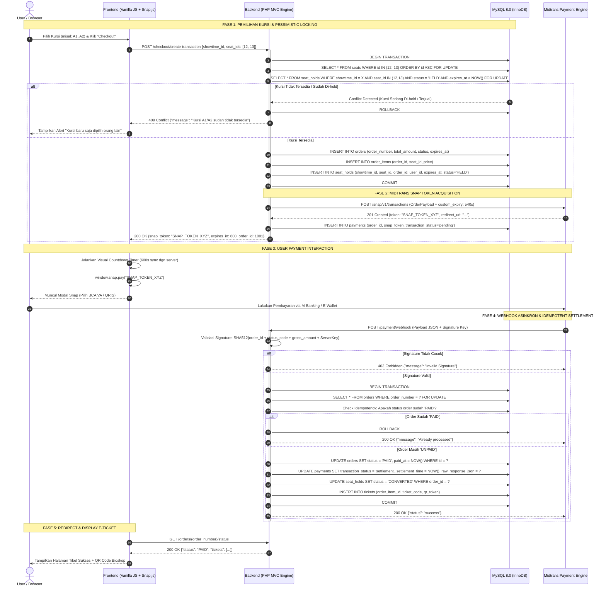
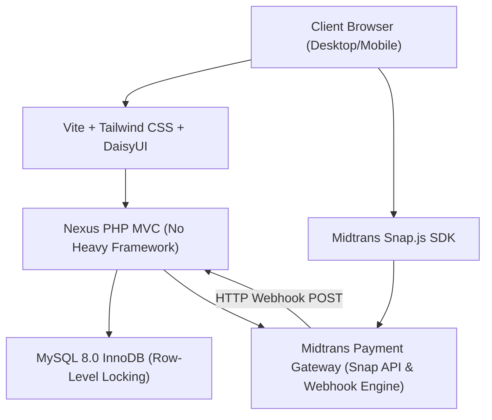

# BAB 1: ARSITEKTUR SISTEM & COMPLETE MIDTRANS PAYMENT FLOW

---

## 1.1 Gambaran Umum Alur Bisnis
Aplikasi ini dirancang untuk menangani beban konkurensi tinggi (*high-concurrency ticket rush*) saat peluncuran film *blockbuster*. Alur transaksi dirancang *fail-safe* dan *strictly consistent* dengan tahapan:

1. **Discovery & Scheduling:** User memilih Film (`movies`), Bioskop (`cinemas`), Studio (`studios`), dan Jam Tayang (`showtimes`).
2. **Interactive Seat Selection:** Frontend memuat layout kursi studio secara real-time. Status ketersediaan kursi dihitung secara dinamis dari kursi yang sudah berstatus `BOOKED` atau sedang `HELD` dengan sisa waktu valid.
3. **Pessimistic Hold & Order Creation:** Saat user menekan tombol checkout, sistem Backend melakukan penguncian pesimistik (`SELECT ... FOR UPDATE`) pada kursi-kursi terkait dengan pengurutan ID kanonikal (*canonical sorting*). Jika semua kursi valid dan tersedia, baris pada `orders` dan `seat_holds` dibuat dengan masa berlaku *Time-To-Live* (TTL) tepat 10 menit (600 detik).
4. **Midtrans Snap Token Exchange:** Backend melakukan panggilan sinkron ke Midtrans API (`/snap/v1/transactions`) dengan menyertakan payload `custom_expiry`. Parameter expiry disinkronkan persis dengan sisa waktu hold kursi dikurangi batas penyangga (*safety buffer*).
5. **Payment Gateway Popup:** Frontend memanggil `window.snap.pay(snapToken)` dan menampilkan countdown timer visual yang disinkronkan dengan jam server. User menyelesaikan pembayaran (Virtual Account BCA/Mandiri/BRI, QRIS/GoPay/ShopeePay, atau Kartu Kredit).
6. **Asynchronous Webhook Processing:** Midtrans mengirimkan notifikasi HTTP POST ke endpoint `/payment/webhook`. Backend memverifikasi otentisitas payload menggunakan Signature Key SHA-512, mengeksekusi *idempotency lock*, mengubah status order menjadi `PAID`, mengonversi status kursi dari `HELD` menjadi `CONVERTED` (resmi `BOOKED`), dan menerbitkan tiket digital serta QR Code.
7. **Client Feedback:** Webhook memicu pembaruan state database, dan saat user dialihkan ke halaman callback `/checkout/finish`, sistem menampilkan tiket resmi.

---

## 1.2 Sequence Diagram Lengkap (End-to-End)

---

## 1.3 Peran Tiap Komponen Sistem

1. **Client Browser & Modular Vanilla JS:** Menangani *seat layout rendering*, pemilih baris/kursi, *server-time offset calculation*, dan memanggil modal `window.snap.pay`.
2. **Nexus PHP MVC Framework:** Engine backend murni dengan arsitektur bersih, kepatuhan *strict types*, penanganan rute, Form Request validation, transaksi pesimistik database, dan verifikasi kriptografi.
3. **MySQL 8.0 InnoDB:** Menyimpan data dengan integritas referensial ketat (*Foreign Keys*), mengisolasi baris dengan `SELECT ... FOR UPDATE`, serta indeks komposit untuk kueri berkecepatan tinggi.
4. **Midtrans Engine:** Menerima metode pembayaran lokal (BCA/Mandiri/BRI VA, QRIS, GoPay, ShopeePay, Kartu Kredit), mengelola masa kedaluwarsa pembayaran (*custom expiry*), dan mengirim notifikasi *webhook* secara asinkron.
