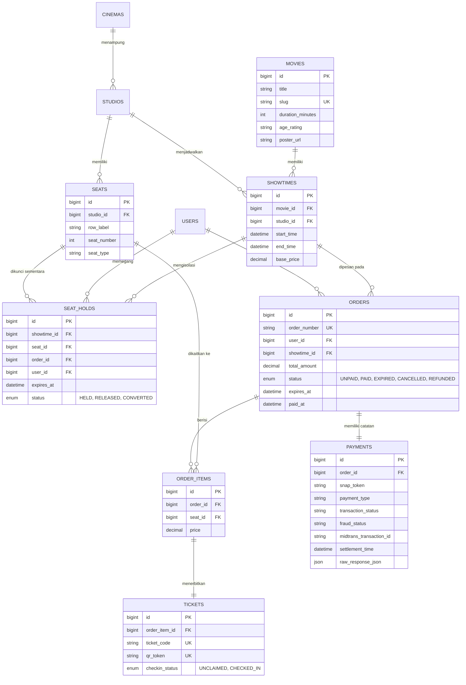

# BAB 2: SKEMA DATABASE & ERD LENGKAP

---

## 2.1 Entity Relationship Diagram (ERD)

Berikut adalah diagram relasi antarentitas lengkap yang memodelkan bisnis bioskop, pemesanan tiket, konkurensi hold, dan jejak audit pembayaran Midtrans:



---

## 2.2 Data Definition Language (DDL) Produksi (MySQL 8.0+ InnoDB)

Skema database di bawah ini dirancang dengan standar performa tinggi, memanfaatkan `BIGINT UNSIGNED`, *Foreign Keys*, dan *Composite Indexing* yang dioptimalkan untuk kueri pesimistik `SELECT ... FOR UPDATE`:

```sql
-- Pastikan karakter set mendukung UTF-8 Multibyte
SET NAMES utf8mb4;
SET FOREIGN_KEY_CHECKS = 0;

-- 1. TABEL MOVIES
CREATE TABLE `movies` (
    `id` BIGINT UNSIGNED NOT NULL AUTO_INCREMENT,
    `title` VARCHAR(255) NOT NULL,
    `slug` VARCHAR(255) NOT NULL UNIQUE,
    `synopsis` TEXT NULL,
    `duration_minutes` INT UNSIGNED NOT NULL,
    `age_rating` ENUM('SU', '13+', '17+', '21+') NOT NULL DEFAULT '13+',
    `poster_url` VARCHAR(500) NULL,
    `trailer_url` VARCHAR(500) NULL,
    `status` ENUM('COMING_SOON', 'NOW_PLAYING', 'ARCHIVED') NOT NULL DEFAULT 'NOW_PLAYING',
    `created_at` DATETIME NOT NULL DEFAULT CURRENT_TIMESTAMP,
    `updated_at` DATETIME NOT NULL DEFAULT CURRENT_TIMESTAMP ON UPDATE CURRENT_TIMESTAMP,
    PRIMARY KEY (`id`),
    INDEX `idx_movies_status` (`status`)
) ENGINE=InnoDB DEFAULT CHARSET=utf8mb4 COLLATE=utf8mb4_unicode_ci;

-- 2. TABEL CINEMAS
CREATE TABLE `cinemas` (
    `id` BIGINT UNSIGNED NOT NULL AUTO_INCREMENT,
    `code` VARCHAR(50) NOT NULL UNIQUE,
    `name` VARCHAR(255) NOT NULL,
    `city` VARCHAR(100) NOT NULL,
    `address` TEXT NOT NULL,
    `is_active` TINYINT(1) NOT NULL DEFAULT 1,
    `created_at` DATETIME NOT NULL DEFAULT CURRENT_TIMESTAMP,
    `updated_at` DATETIME NOT NULL DEFAULT CURRENT_TIMESTAMP ON UPDATE CURRENT_TIMESTAMP,
    PRIMARY KEY (`id`),
    INDEX `idx_cinemas_city` (`city`)
) ENGINE=InnoDB DEFAULT CHARSET=utf8mb4 COLLATE=utf8mb4_unicode_ci;

-- 3. TABEL STUDIOS
CREATE TABLE `studios` (
    `id` BIGINT UNSIGNED NOT NULL AUTO_INCREMENT,
    `cinema_id` BIGINT UNSIGNED NOT NULL,
    `name` VARCHAR(100) NOT NULL,
    `studio_type` ENUM('REGULAR', 'DELUXE', 'IMAX', 'PREMIERE') NOT NULL DEFAULT 'REGULAR',
    `capacity` INT UNSIGNED NOT NULL,
    `created_at` DATETIME NOT NULL DEFAULT CURRENT_TIMESTAMP,
    `updated_at` DATETIME NOT NULL DEFAULT CURRENT_TIMESTAMP ON UPDATE CURRENT_TIMESTAMP,
    PRIMARY KEY (`id`),
    CONSTRAINT `fk_studios_cinema` FOREIGN KEY (`cinema_id`) REFERENCES `cinemas` (`id`) ON DELETE CASCADE
) ENGINE=InnoDB DEFAULT CHARSET=utf8mb4 COLLATE=utf8mb4_unicode_ci;

-- 4. TABEL SEATS (Master Kursi Fisik per Studio)
CREATE TABLE `seats` (
    `id` BIGINT UNSIGNED NOT NULL AUTO_INCREMENT,
    `studio_id` BIGINT UNSIGNED NOT NULL,
    `row_label` VARCHAR(5) NOT NULL,          -- Contoh: 'A', 'B', ... 'K'
    `seat_number` SMALLINT UNSIGNED NOT NULL, -- Contoh: 1, 2, ... 20
    `seat_type` ENUM('STANDARD', 'SWEETBOX', 'WHEELCHAIR') NOT NULL DEFAULT 'STANDARD',
    `is_active` TINYINT(1) NOT NULL DEFAULT 1,
    `created_at` DATETIME NOT NULL DEFAULT CURRENT_TIMESTAMP,
    PRIMARY KEY (`id`),
    UNIQUE KEY `uk_studio_seat` (`studio_id`, `row_label`, `seat_number`),
    INDEX `idx_seats_studio` (`studio_id`, `is_active`),
    CONSTRAINT `fk_seats_studio` FOREIGN KEY (`studio_id`) REFERENCES `studios` (`id`) ON DELETE CASCADE
) ENGINE=InnoDB DEFAULT CHARSET=utf8mb4 COLLATE=utf8mb4_unicode_ci;

-- 5. TABEL SHOWTIMES
CREATE TABLE `showtimes` (
    `id` BIGINT UNSIGNED NOT NULL AUTO_INCREMENT,
    `movie_id` BIGINT UNSIGNED NOT NULL,
    `studio_id` BIGINT UNSIGNED NOT NULL,
    `start_time` DATETIME NOT NULL,
    `end_time` DATETIME NOT NULL,
    `base_price` DECIMAL(12, 2) NOT NULL,
    `status` ENUM('ACTIVE', 'CANCELLED', 'FINISHED') NOT NULL DEFAULT 'ACTIVE',
    `created_at` DATETIME NOT NULL DEFAULT CURRENT_TIMESTAMP,
    `updated_at` DATETIME NOT NULL DEFAULT CURRENT_TIMESTAMP ON UPDATE CURRENT_TIMESTAMP,
    PRIMARY KEY (`id`),
    INDEX `idx_showtimes_schedule` (`studio_id`, `start_time`),
    INDEX `idx_showtimes_movie` (`movie_id`, `start_time`),
    CONSTRAINT `fk_showtimes_movie` FOREIGN KEY (`movie_id`) REFERENCES `movies` (`id`) ON DELETE RESTRICT,
    CONSTRAINT `fk_showtimes_studio` FOREIGN KEY (`studio_id`) REFERENCES `studios` (`id`) ON DELETE RESTRICT
) ENGINE=InnoDB DEFAULT CHARSET=utf8mb4 COLLATE=utf8mb4_unicode_ci;

-- 6. TABEL USERS
CREATE TABLE `users` (
    `id` BIGINT UNSIGNED NOT NULL AUTO_INCREMENT,
    `name` VARCHAR(150) NOT NULL,
    `email` VARCHAR(191) NOT NULL UNIQUE,
    `phone` VARCHAR(30) NOT NULL,
    `password_hash` VARCHAR(255) NOT NULL,
    `created_at` DATETIME NOT NULL DEFAULT CURRENT_TIMESTAMP,
    `updated_at` DATETIME NOT NULL DEFAULT CURRENT_TIMESTAMP ON UPDATE CURRENT_TIMESTAMP,
    PRIMARY KEY (`id`),
    INDEX `idx_users_phone` (`phone`)
) ENGINE=InnoDB DEFAULT CHARSET=utf8mb4 COLLATE=utf8mb4_unicode_ci;

-- 7. TABEL ORDERS
CREATE TABLE `orders` (
    `id` BIGINT UNSIGNED NOT NULL AUTO_INCREMENT,
    `order_number` VARCHAR(64) NOT NULL UNIQUE, -- Format: 'NEXUS-20261015-8F92A'
    `user_id` BIGINT UNSIGNED NOT NULL,
    `showtime_id` BIGINT UNSIGNED NOT NULL,
    `total_seats` SMALLINT UNSIGNED NOT NULL,
    `total_amount` DECIMAL(12, 2) NOT NULL,
    `status` ENUM('UNPAID', 'PAID', 'EXPIRED', 'CANCELLED', 'REFUNDED') NOT NULL DEFAULT 'UNPAID',
    `expires_at` DATETIME NOT NULL,             -- Batas waktu hold 10 menit
    `paid_at` DATETIME NULL,
    `cancelled_at` DATETIME NULL,
    `created_at` DATETIME NOT NULL DEFAULT CURRENT_TIMESTAMP,
    `updated_at` DATETIME NOT NULL DEFAULT CURRENT_TIMESTAMP ON UPDATE CURRENT_TIMESTAMP,
    PRIMARY KEY (`id`),
    INDEX `idx_orders_user` (`user_id`),
    INDEX `idx_orders_showtime` (`showtime_id`),
    INDEX `idx_orders_status_expires` (`status`, `expires_at`),
    CONSTRAINT `fk_orders_user` FOREIGN KEY (`user_id`) REFERENCES `users` (`id`) ON DELETE RESTRICT,
    CONSTRAINT `fk_orders_showtime` FOREIGN KEY (`showtime_id`) REFERENCES `showtimes` (`id`) ON DELETE RESTRICT
) ENGINE=InnoDB DEFAULT CHARSET=utf8mb4 COLLATE=utf8mb4_unicode_ci;

-- 8. TABEL ORDER_ITEMS (Item Kursi per Order)
CREATE TABLE `order_items` (
    `id` BIGINT UNSIGNED NOT NULL AUTO_INCREMENT,
    `order_id` BIGINT UNSIGNED NOT NULL,
    `seat_id` BIGINT UNSIGNED NOT NULL,
    `price` DECIMAL(12, 2) NOT NULL,
    `created_at` DATETIME NOT NULL DEFAULT CURRENT_TIMESTAMP,
    PRIMARY KEY (`id`),
    UNIQUE KEY `uk_order_seat` (`order_id`, `seat_id`),
    INDEX `idx_order_items_seat` (`seat_id`),
    CONSTRAINT `fk_order_items_order` FOREIGN KEY (`order_id`) REFERENCES `orders` (`id`) ON DELETE CASCADE,
    CONSTRAINT `fk_order_items_seat` FOREIGN KEY (`seat_id`) REFERENCES `seats` (`id`) ON DELETE RESTRICT
) ENGINE=InnoDB DEFAULT CHARSET=utf8mb4 COLLATE=utf8mb4_unicode_ci;

-- 9. TABEL SEAT_HOLDS (Tabel Kritis State Penguncian Kursi Sementara)
CREATE TABLE `seat_holds` (
    `id` BIGINT UNSIGNED NOT NULL AUTO_INCREMENT,
    `showtime_id` BIGINT UNSIGNED NOT NULL,
    `seat_id` BIGINT UNSIGNED NOT NULL,
    `order_id` BIGINT UNSIGNED NOT NULL,
    `user_id` BIGINT UNSIGNED NOT NULL,
    `status` ENUM('HELD', 'RELEASED', 'CONVERTED') NOT NULL DEFAULT 'HELD',
    `held_at` DATETIME NOT NULL DEFAULT CURRENT_TIMESTAMP,
    `expires_at` DATETIME NOT NULL,
    PRIMARY KEY (`id`),
    -- Composite Index krusial untuk kueri SELECT FOR UPDATE berkecepatan tinggi:
    INDEX `idx_active_holds` (`showtime_id`, `seat_id`, `status`, `expires_at`),
    INDEX `idx_order_holds` (`order_id`),
    CONSTRAINT `fk_holds_showtime` FOREIGN KEY (`showtime_id`) REFERENCES `showtimes` (`id`) ON DELETE CASCADE,
    CONSTRAINT `fk_holds_seat` FOREIGN KEY (`seat_id`) REFERENCES `seats` (`id`) ON DELETE CASCADE,
    CONSTRAINT `fk_holds_order` FOREIGN KEY (`order_id`) REFERENCES `orders` (`id`) ON DELETE CASCADE,
    CONSTRAINT `fk_holds_user` FOREIGN KEY (`user_id`) REFERENCES `users` (`id`) ON DELETE CASCADE
) ENGINE=InnoDB DEFAULT CHARSET=utf8mb4 COLLATE=utf8mb4_unicode_ci;

-- 10. TABEL PAYMENTS (Audit Trail Pembayaran & Payload Midtrans)
CREATE TABLE `payments` (
    `id` BIGINT UNSIGNED NOT NULL AUTO_INCREMENT,
    `order_id` BIGINT UNSIGNED NOT NULL UNIQUE,
    `snap_token` VARCHAR(255) NULL,
    `payment_type` VARCHAR(50) NULL,              -- qris, bank_transfer, gopay, cstore, dll.
    `transaction_status` VARCHAR(50) NOT NULL DEFAULT 'pending',
    `fraud_status` VARCHAR(50) NULL,              -- accept, challenge, deny
    `midtrans_transaction_id` VARCHAR(100) NULL UNIQUE,
    `gross_amount` DECIMAL(12, 2) NOT NULL,
    `settlement_time` DATETIME NULL,
    `raw_response_json` JSON NULL,               -- Payload lengkap webhook disimpan sebagai immutable audit log
    `created_at` DATETIME NOT NULL DEFAULT CURRENT_TIMESTAMP,
    `updated_at` DATETIME NOT NULL DEFAULT CURRENT_TIMESTAMP ON UPDATE CURRENT_TIMESTAMP,
    PRIMARY KEY (`id`),
    INDEX `idx_payments_midtrans_tx` (`midtrans_transaction_id`),
    INDEX `idx_payments_status` (`transaction_status`),
    CONSTRAINT `fk_payments_order` FOREIGN KEY (`order_id`) REFERENCES `orders` (`id`) ON DELETE CASCADE
) ENGINE=InnoDB DEFAULT CHARSET=utf8mb4 COLLATE=utf8mb4_unicode_ci;

-- 11. TABEL TICKETS (Tiket Resmi Pasca Settlement)
CREATE TABLE `tickets` (
    `id` BIGINT UNSIGNED NOT NULL AUTO_INCREMENT,
    `order_item_id` BIGINT UNSIGNED NOT NULL UNIQUE,
    `ticket_code` VARCHAR(50) NOT NULL UNIQUE,    -- Kode unik pencetakan barcode (Contoh: 'TCK-A1-88319')
    `qr_token` VARCHAR(255) NOT NULL UNIQUE,     -- Token terenkripsi untuk scanner pintu studio
    `checkin_status` ENUM('UNCLAIMED', 'CHECKED_IN') NOT NULL DEFAULT 'UNCLAIMED',
    `checked_in_at` DATETIME NULL,
    `created_at` DATETIME NOT NULL DEFAULT CURRENT_TIMESTAMP,
    PRIMARY KEY (`id`),
    CONSTRAINT `fk_tickets_order_item` FOREIGN KEY (`order_item_id`) REFERENCES `order_items` (`id`) ON DELETE RESTRICT
) ENGINE=InnoDB DEFAULT CHARSET=utf8mb4 COLLATE=utf8mb4_unicode_ci;

SET FOREIGN_KEY_CHECKS = 1;
```

---

## 2.3 Analisis Strategi Indexing untuk High-Concurrency

1. **`idx_active_holds` (`showtime_id`, `seat_id`, `status`, `expires_at`)**:  
   Indeks komposit ini dibuat agar mesin InnoDB dapat melakukan *Index Range Scan* secara presisi tanpa perlu memindai seluruh tabel (*Full Table Scan*). Ketika ratusan kueri `SELECT ... FOR UPDATE` berjalan serentak, MySQL langsung mengunci daun indeks (*Index Record Lock*) spesifik, mencegah penguncian tabel berlebih (*table-level locking*).
2. **`uk_order_seat` (`order_id`, `seat_id`)**:  
   Mencegah duplikasi data kursi dalam satu order di tingkat database (*Physical Data Integrity*).
3. **`idx_orders_status_expires` (`status`, `expires_at`)**:  
   Mempercepat kueri *background cleanup worker* yang berjalan setiap menit (`WHERE status = 'UNPAID' AND expires_at <= NOW()`), sehingga waktu eksekusi berada di bawah 2 milidetik.
