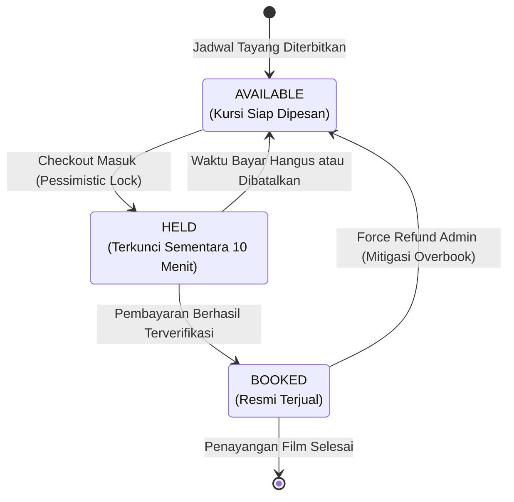
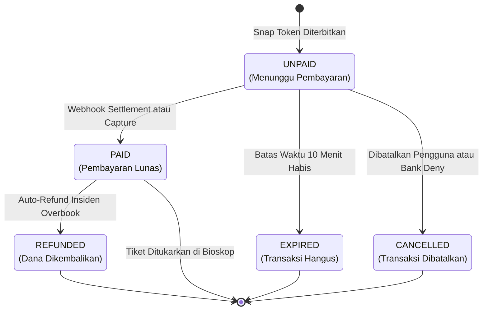

# BAB 3: STATE MACHINE KURSI, TRANSAKSI & MIDTRANS STATUS

---

## 3.1 Diagram Siklus Kursi & Transaksi (State Machine)

Siklus hidup kursi dikontrol secara ketat melalui state transisi di bawah ini:

---

## 3.2 Diagram State Transisi Order & Pembayaran

---

## 3.3 Tabel Pemetaan Status Transaksi Sistem vs Midtrans Engine

Tabel ini menjadi acuan mutlak implementasi logika percabangan pada Service dan Webhook Handler:

| State Internal (`orders.status`) | Status Kursi (`seat_holds.status`) | Midtrans `transaction_status` | Midtrans `fraud_status` | Definisi Bisnis & Tindakan Sistem |
| :--- | :--- | :--- | :--- | :--- |
| **`UNPAID`** | `HELD` | `pending` | `-` | User sedang berada di antarmuka Midtrans Snap. Kursi terkunci aman dengan countdown 10 menit. |
| **`PAID`** | `CONVERTED` (Resmi `BOOKED`) | `settlement` | `accept` | Pembayaran lunas via VA, QRIS, atau E-Wallet. Order diubah menjadi `PAID`, tiket diterbitkan. |
| **`PAID`** | `CONVERTED` (Resmi `BOOKED`) | `capture` | `accept` | Transaksi Kartu Kredit berhasil dan lolos deteksi penipuan (*Fraud Detection System*). Tiket terbit. |
| **`UNPAID`** | `HELD` (Review) | `capture` | `challenge` | Transaksi Kartu Kredit dicurigai mencurigakan oleh sistem Midtrans FDS. Sistem menahan tiket hingga verifikasi admin selesai. |
| **`EXPIRED`** | `RELEASED` (`AVAILABLE`) | `expire` | `-` | Batas waktu bayar Snap habis. Kursi dilepas otomatis ke publik dan order ditandai hangus. |
| **`CANCELLED`**| `RELEASED` (`AVAILABLE`) | `cancel` | `-` | Pengguna membatalkan pembayaran secara manual pada UI Snap. Kursi langsung dilepaskan. |
| **`CANCELLED`**| `RELEASED` (`AVAILABLE`) | `deny` | `deny` | Transaksi ditolak oleh bank penerbit (misal: saldo tidak cukup atau kartu diblokir). Kursi langsung dilepas. |
| **`REFUNDED`** | `RELEASED` / Kompensasi | `refund` / `partial_refund` | `-` | Dana dikembalikan kepada user akibat pembatalan sepihak atau kompensasi bentrok *last-second settlement*. |
