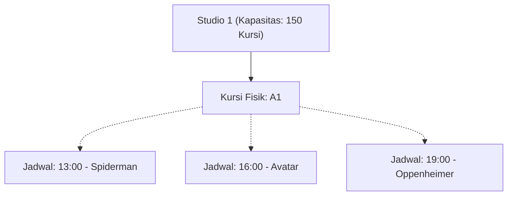
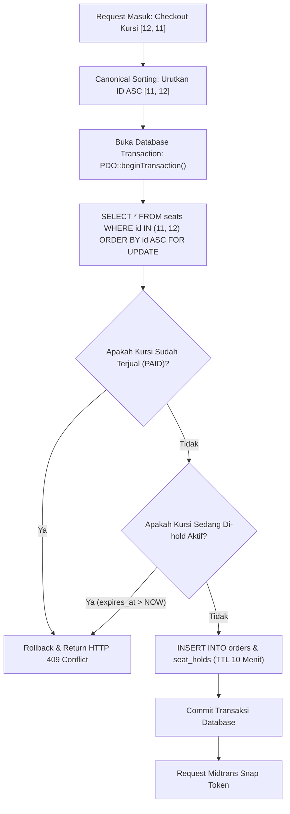
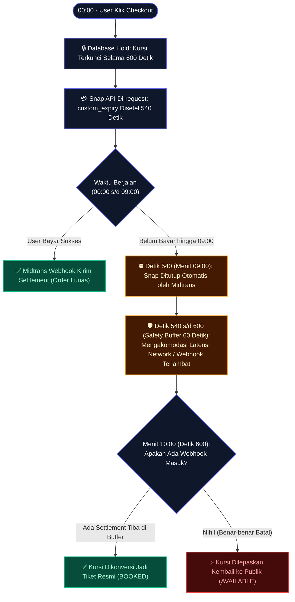

# BAB 4: MEKANISME TEKNIS SEAT LOCKING & SYNCHRONIZED TIMER

---

## 4.1 Cacat Fatal Modifikasi Kolom Status pada Master `seats`
Dalam sistem bioskop, master kursi (`seats`) adalah representasi fisik dari baris dan nomor kursi di dalam studio. Satu studio bioskop memutar film dengan puluhan jadwal tayang (`showtimes`) yang berbeda setiap harinya.



> [!CAUTION]
> Menambahkan kolom status seperti `status ENUM('AVAILABLE', 'LOCKED', 'BOOKED')` pada tabel `seats` adalah **pelanggaran kardinalitas fatal**. Jika kursi A1 diubah menjadi `LOCKED` pada jadwal jam 13:00, maka jadwal jam 16:00 dan 19:00 akan otomatis ikut terkunci secara keliru.

Oleh karena itu, isolasi status ketersediaan kursi dihitung secara dinamis berbasis relasi `showtime_id`:
1. **`BOOKED`**: Kursi tercatat pada `order_items` dengan `orders.status = 'PAID'` dan `orders.showtime_id = :showtime_id`.
2. **`HELD`**: Kursi tercatat pada `seat_holds` dengan `showtime_id = :showtime_id`, `status = 'HELD'`, dan `expires_at > NOW()`.
3. **`AVAILABLE`**: Kursi aktif pada studio yang tidak memenuhi kriteria `BOOKED` maupun `HELD`.

---

## 4.2 Pessimistic Locking & Canonical Sorting
Ketika terjadi lonjakan (*rush*) pemesanan tiket, puluhan pengguna dapat menekan tombol checkout pada kursi yang sama secara bersamaan (konkuren).



### Mengapa Canonical Sorting Wajib?
Jika User A mengunci `[12, 11]` dan User B mengunci `[11, 12]`, maka akan terjadi kebuntuan (*deadlock*):
- Transaksi A mengunci record 12, lalu menunggu record 11.
- Transaksi B mengunci record 11, lalu menunggu record 12.
- InnoDB mendeteksi *cyclic lock dependency* dan melempar error `1213 Deadlock found`.

Dengan melakukan **Canonical Sorting** (`sort($seatIds, SORT_NUMERIC)`):
- Transaksi A selalu meminta kunci secara berurutan: `11` kemudian `12`.
- Transaksi B selalu meminta kunci secara berurutan: `11` kemudian `12`.
- Transaksi B akan langsung tertahan (*wait*) di record 11 sampai Transaksi A selesai, sehingga **mustahil terjadi siklus deadlock**.

---

## 4.3 Strategi Dual-Layer Expiry: Lazy Check vs Cleanup Cron

Sistem menerapkan proteksi kedaluwarsa dua lapis:

### Layer 1: Lazy Expiration (Zero Latency Consistency)
Setiap kali sistem melakukan kueri status ketersediaan kursi atau validasi checkout, kueri database selalu menyertakan predikat waktu kedaluwarsa:
```sql
SELECT seat_id 
FROM seat_holds 
WHERE showtime_id = :showtime_id 
  AND seat_id IN (:seat_ids)
  AND status = 'HELD' 
  AND expires_at > NOW()
FOR UPDATE;
```
Jika waktu saat ini (`NOW()`) telah melampaui `expires_at`, kueri secara otomatis mengabaikan baris hold tersebut. Kursi langsung tersedia kembali untuk pengguna lain tanpa perlu menunggu proses background berjalan.

### Layer 2: Scheduled Background Worker (B-Tree Index Maintenance)
Untuk menjaga agar ukuran tabel `seat_holds` dan pohon indeks B-Tree tidak membengkak (*bloated*), sebuah background worker dijalankan melalui cron setiap 1 menit:
```sql
-- Lepaskan hold yang telah kadaluwarsa
UPDATE seat_holds 
SET status = 'RELEASED' 
WHERE status = 'HELD' 
  AND expires_at <= NOW();

-- Ubah order tertunggak menjadi EXPIRED
UPDATE orders 
SET status = 'EXPIRED' 
WHERE status = 'UNPAID' 
  AND expires_at <= NOW();
```

---

## 4.4 Sinkronisasi Presisi: Midtrans `custom_expiry` vs Database TTL

Salah satu sumber utama kegagalan pada integrasi payment gateway tiket adalah *time disparity* (perbedaan waktu kedaluwarsa). Jika Midtrans masih menerima pembayaran di menit ke-10 detik ke-10, padahal server lokal sudah melepaskan kursi di menit ke-10 detik ke-00, akan terjadi insiden fatal di mana kursi diambil orang lain sementara uang pelanggan sudah terpotong.

<div class="card bg-base-300/60 border border-white/10 p-5 my-6 rounded-2xl shadow-xl">
    <div class="flex items-center justify-between mb-4">
        <span class="text-xs font-mono font-bold text-white flex items-center gap-2">
            <span class="w-2.5 h-2.5 rounded-full bg-primary animate-pulse"></span>
            Dual-Layer Expiry Synchronization Timeline (Asymmetric Window)
        </span>
        <span class="badge badge-sm badge-primary font-mono text-xs">Buffer Aman: 60 Detik</span>
    </div>

    <!-- Layer 1: Database Hold TTL -->
    <div class="mb-4">
        <div class="flex justify-between text-xs font-mono mb-1.5 text-slate-300">
            <span class="font-semibold text-indigo-300">Layer 1: Database Hold TTL (Server Lokal)</span>
            <span class="text-primary font-bold">10:00 Menit (600 Detik)</span>
        </div>
        <div class="w-full bg-slate-900 rounded-xl h-10 overflow-hidden flex border border-indigo-500/30 p-1">
            <div class="bg-gradient-to-r from-indigo-600 via-indigo-500 to-primary text-white text-xs font-mono font-semibold flex items-center justify-center rounded-lg w-full shadow-inner">
                🔒 Kursi Terkunci Penuh di Database MySQL (00:00 s/d 10:00)
            </div>
        </div>
    </div>

    <!-- Layer 2: Midtrans Snap Expiry Window -->
    <div class="mb-3">
        <div class="flex justify-between text-xs font-mono mb-1.5 text-slate-300">
            <span class="font-semibold text-emerald-300">Layer 2: Midtrans Snap Window & Safety Buffer</span>
            <span class="text-warning font-bold">540s Pembayaran + 60s Buffer</span>
        </div>
        <div class="w-full bg-slate-900 rounded-xl h-10 overflow-hidden flex border border-white/10 p-1 gap-1.5">
            <div class="bg-gradient-to-r from-emerald-600 to-teal-500 text-white text-xs font-mono font-semibold flex items-center justify-center rounded-lg shadow-inner" style="width: 90%;">
                💳 Snap Gateway Aktif Menerima Bayar (00:00 s/d 09:00)
            </div>
            <div class="bg-gradient-to-r from-amber-600 to-rose-600 text-white text-[11px] font-mono font-bold flex items-center justify-center rounded-lg shadow-inner text-center" style="width: 10%;">
                🛡️ 60s Buffer
            </div>
        </div>
    </div>

    <div class="flex justify-between text-[11px] font-mono text-slate-400 mt-3 px-1 border-t border-white/5 pt-2">
        <span>⏱️ Detik 0 (Checkout Dimulai)</span>
        <span class="text-emerald-400">⛔ Detik 540 (Snap Ditutup Midtrans)</span>
        <span class="text-rose-400">⚡ Detik 600 (Database Lepas Kursi)</span>
    </div>
</div>



### Formula Sinkronisasi:
$$\text{Durasi Snap Midtrans} = \text{TTL Database Lokal} - \text{Safety Buffer}$$
$$T_{\text{snap}} = 600\text{ detik} - 60\text{ detik} = 540\text{ detik (9 menit)}$$

Dengan menyetel parameter `custom_expiry` di Snap API menjadi **9 menit**:
1. User hanya dapat membayar melalui QRIS / Virtual Account hingga menit ke-09:00.
2. Pada menit 09:01 s/d 10:00, Midtrans sudah memblokir seluruh upaya pembayaran baru.
3. Jeda waktu 60 detik (*Safety Buffer*) ini dialokasikan untuk mengakomodasi latensi jaringan perbankan saat mengirimkan webhook `settlement` ke server kita sebelum kursi dilepas ke publik pada menit ke-10:00.
