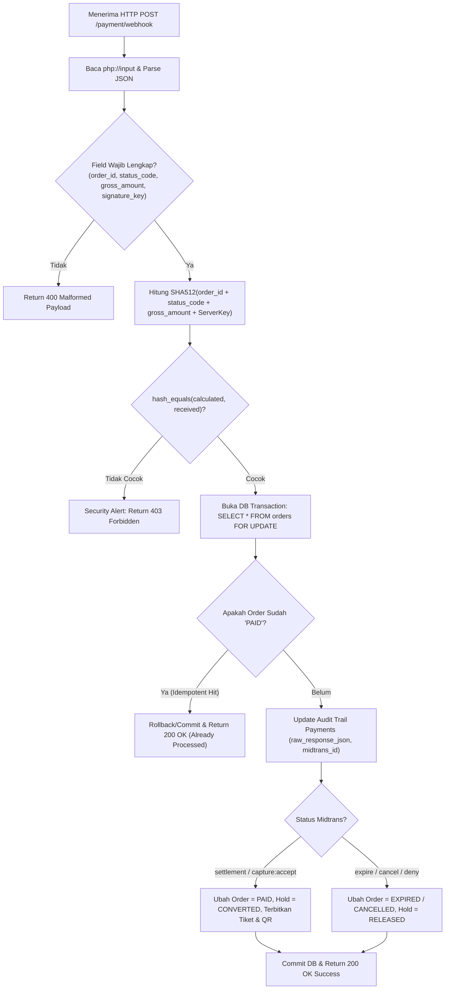

# BAB 5: SPESIFIKASI ENDPOINT & WEBHOOK HANDLER IDEMPOTEN

---

## 5.1 Service Controller: Checkout & Create Transaction

Implementasi controller PHP MVC murni dengan arsitektur modular, kepatuhan `declare(strict_types=1);`, penanganan transaksi pesimistik, dan perolehan Snap Token:

```php
<?php

declare(strict_types=1);

namespace App\Controllers;

use Core\Http\Request;
use Core\Http\Response;
use Core\Database\Database;
use Exception;
use PDO;

final class CheckoutController
{
    private const HOLD_DURATION_SECONDS = 600; // 10 Menit TTL
    private const MIDTRANS_EXPIRY_BUFFER_SECONDS = 60; // 1 Menit Penyangga

    /**
     * Endpoint: POST /checkout/create-transaction
     * Mengunci kursi secara atomik dan meminta Snap Token ke Midtrans.
     */
    public function createTransaction(Request $request): Response
    {
        $userId = $request->user()->id; // Mengambil data user terotentikasi
        $showtimeId = (int) $request->input('showtime_id');
        $seatIds = (array) $request->input('seat_ids', []);

        if ($showtimeId <= 0 || empty($seatIds)) {
            return Response::json(['message' => 'Parameter tidak valid'], 422);
        }

        // 1. KANONIKAL SORTING: Mengurutkan ID kursi secara ASC untuk mencegah deadlock InnoDB
        $seatIds = array_map('intval', $seatIds);
        sort($seatIds, SORT_NUMERIC);
        $seatCount = count($seatIds);

        $db = Database::connection();
        $db->beginTransaction();

        try {
            // 2. Kunci baris kursi fisik untuk memastikan validitas data
            $inPlaceholders = implode(',', array_fill(0, $seatCount, '?'));
            $seatStmt = $db->prepare("
                SELECT id FROM seats 
                WHERE id IN ($inPlaceholders) AND is_active = 1 
                ORDER BY id ASC FOR UPDATE
            ");
            $seatStmt->execute($seatIds);
            $validSeats = $seatStmt->fetchAll(PDO::FETCH_COLUMN);

            if (count($validSeats) !== $seatCount) {
                $db->rollBack();
                return Response::json(['message' => 'Beberapa kursi tidak valid atau dinonaktifkan.'], 404);
            }

            // 3. Validasi apakah kursi sudah berstatus BOOKED permanen (PAID)
            $bookedStmt = $db->prepare("
                SELECT oi.seat_id 
                FROM order_items oi
                JOIN orders o ON o.id = oi.order_id
                WHERE o.showtime_id = ? 
                  AND oi.seat_id IN ($inPlaceholders)
                  AND o.status = 'PAID'
                FOR UPDATE
            ");
            $bookedStmt->execute(array_merge([$showtimeId], $seatIds));
            if ($bookedStmt->rowCount() > 0) {
                $db->rollBack();
                return Response::json(['message' => 'Kursi pilihan Anda sudah terjual.'], 409);
            }

            // 4. Validasi apakah kursi sedang di-HOLD aktif oleh orang lain
            $holdStmt = $db->prepare("
                SELECT seat_id 
                FROM seat_holds 
                WHERE showtime_id = ? 
                  AND seat_id IN ($inPlaceholders)
                  AND status = 'HELD' 
                  AND expires_at > NOW()
                FOR UPDATE
            ");
            $holdStmt->execute(array_merge([$showtimeId], $seatIds));
            if ($holdStmt->rowCount() > 0) {
                $db->rollBack();
                return Response::json(['message' => 'Kursi sedang dipilih pengguna lain. Silakan pilih kursi lain.'], 409);
            }

            // Ambil data harga jadwal tayang
            $showtimeStmt = $db->prepare("SELECT base_price FROM showtimes WHERE id = ? FOR UPDATE");
            $showtimeStmt->execute([$showtimeId]);
            $basePrice = (float) $showtimeStmt->fetchColumn();
            $totalAmount = $basePrice * $seatCount;

            // 5. Buat entri ORDER
            $orderNumber = 'NEXUS-' . date('YmdHis') . '-' . strtoupper(bin2hex(random_bytes(3)));
            $expiresAt = date('Y-m-d H:i:s', time() + self::HOLD_DURATION_SECONDS);

            $orderInsert = $db->prepare("
                INSERT INTO orders (order_number, user_id, showtime_id, total_seats, total_amount, status, expires_at)
                VALUES (?, ?, ?, ?, ?, 'UNPAID', ?)
            ");
            $orderInsert->execute([$orderNumber, $userId, $showtimeId, $seatCount, $totalAmount, $expiresAt]);
            $orderId = (int) $db->lastInsertId();

            // 6. Buat entri ORDER_ITEMS & SEAT_HOLDS
            $itemInsert = $db->prepare("INSERT INTO order_items (order_id, seat_id, price) VALUES (?, ?, ?)");
            $holdInsert = $db->prepare("
                INSERT INTO seat_holds (showtime_id, seat_id, order_id, user_id, status, held_at, expires_at)
                VALUES (?, ?, ?, ?, 'HELD', NOW(), ?)
            ");

            foreach ($seatIds as $sId) {
                $itemInsert->execute([$orderId, $sId, $basePrice]);
                $holdInsert->execute([$showtimeId, $sId, $orderId, $userId, $expiresAt]);
            }

            // 7. Request Midtrans Snap Token dengan Sinkronisasi Expiry
            $midtransExpiryMinutes = (int) floor((self::HOLD_DURATION_SECONDS - self::MIDTRANS_EXPIRY_BUFFER_SECONDS) / 60);
            $snapPayload = [
                'transaction_details' => [
                    'order_id' => $orderNumber,
                    'gross_amount' => (int) $totalAmount,
                ],
                'customer_details' => [
                    'first_name' => $request->user()->name,
                    'email' => $request->user()->email,
                    'phone' => $request->user()->phone,
                ],
                'expiry' => [
                    'start_time' => date('Y-m-d H:i:s O'),
                    'unit' => 'minute',
                    'duration' => $midtransExpiryMinutes,
                ],
            ];

            $snapToken = $this->callMidtransSnapApi($snapPayload);

            // Simpan record payment
            $paymentInsert = $db->prepare("
                INSERT INTO payments (order_id, snap_token, gross_amount, transaction_status)
                VALUES (?, ?, ?, 'pending')
            ");
            $paymentInsert->execute([$orderId, $snapToken, $totalAmount]);

            // Commit transaksi database
            $db->commit();

            return Response::json([
                'status' => 'success',
                'order_number' => $orderNumber,
                'snap_token' => $snapToken,
                'expires_at' => $expiresAt,
                'expires_in_seconds' => self::HOLD_DURATION_SECONDS,
            ], 201);

        } catch (Exception $e) {
            $db->rollBack();
            return Response::json([
                'message' => 'Terjadi kesalahan sistem saat memproses checkout.',
                'error' => $e->getMessage(),
            ], 500);
        }
    }

    private function callMidtransSnapApi(array $payload): string
    {
        $serverKey = (string) getenv('MIDTRANS_SERVER_KEY');
        $isProduction = filter_var(getenv('MIDTRANS_IS_PRODUCTION'), FILTER_VALIDATE_BOOLEAN);
        $url = $isProduction 
            ? 'https://app.midtrans.com/snap/v1/transactions' 
            : 'https://app.sandbox.midtrans.com/snap/v1/transactions';

        $ch = curl_init($url);
        curl_setopt($ch, CURLOPT_POST, 1);
        curl_setopt($ch, CURLOPT_POSTFIELDS, json_encode($payload));
        curl_setopt($ch, CURLOPT_RETURNTRANSFER, true);
        curl_setopt($ch, CURLOPT_HTTPHEADER, [
            'Content-Type: application/json',
            'Accept: application/json',
            'Authorization: Basic ' . base64_encode($serverKey . ':')
        ]);

        $response = curl_exec($ch);
        $httpCode = curl_getinfo($ch, CURLINFO_HTTP_CODE);
        curl_close($ch);

        if ($httpCode !== 201 || !$response) {
            throw new Exception("Gagal memperoleh Snap Token dari Midtrans. HTTP Code: {$httpCode}");
        }

        $resData = json_decode($response, true);
        return $resData['token'];
    }
}
```

---

## 5.2 Webhook Handler Idempoten & Verifikasi Kriptografis Signature SHA-512



### Implementasi PHP Webhook Controller:
```php
<?php

declare(strict_types=1);

namespace App\Controllers;

use Core\Http\Request;
use Core\Http\Response;
use Core\Database\Database;
use Exception;
use PDO;

final class PaymentWebhookController
{
    /**
     * Endpoint: POST /payment/webhook
     * Handler notifikasi Midtrans dengan jaminan Idempotensi dan Verifikasi Keamanan SHA-512.
     */
    public function handle(Request $request): Response
    {
        $rawPayload = (string) file_get_contents('php://input');
        $data = json_decode($rawPayload, true);

        if (!$data || !isset($data['order_id'], $data['status_code'], $data['gross_amount'], $data['signature_key'])) {
            return Response::json(['message' => 'Malformed Webhook Payload'], 400);
        }

        $orderNumber = (string) $data['order_id'];
        $statusCode = (string) $data['status_code'];
        $grossAmount = (string) $data['gross_amount'];
        $receivedSignature = (string) $data['signature_key'];
        $serverKey = (string) getenv('MIDTRANS_SERVER_KEY');

        // 1. VERIFIKASI SIGNATURE KEY SHA-512 DENGAN TIMING-ATTACK SAFE COMPARISON
        $calculatedSignature = hash('sha512', $orderNumber . $statusCode . $grossAmount . $serverKey);
        if (!hash_equals($calculatedSignature, $receivedSignature)) {
            error_log("SECURITY ALERT: Invalid Signature Key attempted for order {$orderNumber}");
            return Response::json(['message' => 'Unauthorized: Invalid Signature'], 403);
        }

        $transactionStatus = (string) ($data['transaction_status'] ?? '');
        $fraudStatus = (string) ($data['fraud_status'] ?? '');
        $midtransTxId = (string) ($data['transaction_id'] ?? '');
        $paymentType = (string) ($data['payment_type'] ?? '');
        $settlementTime = $data['settlement_time'] ?? date('Y-m-d H:i:s');

        $db = Database::connection();
        $db->beginTransaction();

        try {
            // 2. KUNCI BARIS ORDER DENGAN PESSIMISTIC LOCK (SELECT ... FOR UPDATE)
            $orderStmt = $db->prepare("SELECT * FROM orders WHERE order_number = ? FOR UPDATE");
            $orderStmt->execute([$orderNumber]);
            $order = $orderStmt->fetch(PDO::FETCH_ASSOC);

            if (!$order) {
                $db->rollBack();
                return Response::json(['message' => 'Order Not Found'], 404);
            }

            // 3. JAMINAN IDEMPOTENSI (IDEMPOTENCY GUARD)
            // Jika webhook dikirim ulang oleh Midtrans untuk order yang sudah PAID, langsung kembalikan 200 OK.
            if ($order['status'] === 'PAID') {
                $db->commit();
                return Response::json(['message' => 'Order already processed (Idempotent Hit)'], 200);
            }

            // Simpan audit trail di tabel payments
            $payUpdate = $db->prepare("
                UPDATE payments 
                SET midtrans_transaction_id = ?,
                    payment_type = ?,
                    transaction_status = ?,
                    fraud_status = ?,
                    settlement_time = ?,
                    raw_response_json = ?,
                    updated_at = NOW()
                WHERE order_id = ?
            ");
            $payUpdate->execute([
                $midtransTxId,
                $paymentType,
                $transactionStatus,
                $fraudStatus,
                $settlementTime,
                $rawPayload,
                $order['id']
            ]);

            // 4. TRANSISI STATE BERDASARKAN STATUS MIDTRANS
            if ($transactionStatus === 'settlement' || ($transactionStatus === 'capture' && $fraudStatus === 'accept')) {
                // Pembayaran Sah: Update status order menjadi PAID
                $updateOrder = $db->prepare("UPDATE orders SET status = 'PAID', paid_at = NOW() WHERE id = ?");
                $updateOrder->execute([$order['id']]);

                // Ubah status seat_holds menjadi CONVERTED (Resmi Terjual)
                $updateHolds = $db->prepare("UPDATE seat_holds SET status = 'CONVERTED' WHERE order_id = ?");
                $updateHolds->execute([$order['id']]);

                // Terbitkan Tiket dan QR Token untuk setiap kursi
                $itemsStmt = $db->prepare("
                    SELECT oi.id, oi.seat_id, s.row_label, s.seat_number 
                    FROM order_items oi
                    JOIN seats s ON s.id = oi.seat_id
                    WHERE oi.order_id = ?
                ");
                $itemsStmt->execute([$order['id']]);
                $items = $itemsStmt->fetchAll(PDO::FETCH_ASSOC);

                $ticketInsert = $db->prepare("
                    INSERT INTO tickets (order_item_id, ticket_code, qr_token, checkin_status)
                    VALUES (?, ?, ?, 'UNCLAIMED')
                ");

                foreach ($items as $item) {
                    $ticketCode = 'TCK-' . $item['row_label'] . $item['seat_number'] . '-' . strtoupper(bin2hex(random_bytes(3)));
                    $qrToken = hash('sha256', $ticketCode . $orderNumber . bin2hex(random_bytes(16)));
                    $ticketInsert->execute([$item['id'], $ticketCode, $qrToken]);
                }

            } elseif (in_array($transactionStatus, ['expire', 'cancel', 'deny'], true)) {
                // Pembayaran Kadaluwarsa / Dibatalkan: Lepas kunci kursi kembali ke AVAILABLE
                $newStatus = ($transactionStatus === 'expire') ? 'EXPIRED' : 'CANCELLED';
                $updateOrder = $db->prepare("UPDATE orders SET status = ?, cancelled_at = NOW() WHERE id = ?");
                $updateOrder->execute([$newStatus, $order['id']]);

                $releaseHolds = $db->prepare("UPDATE seat_holds SET status = 'RELEASED' WHERE order_id = ?");
                $releaseHolds->execute([$order['id']]);
            }

            $db->commit();
            return Response::json(['status' => 'success', 'message' => 'Webhook successfully processed'], 200);

        } catch (Exception $e) {
            $db->rollBack();
            error_log("WEBHOOK FATAL ERROR: " . $e->getMessage());
            return Response::json(['message' => 'Internal Processing Error'], 500);
        }
    }
}
```
