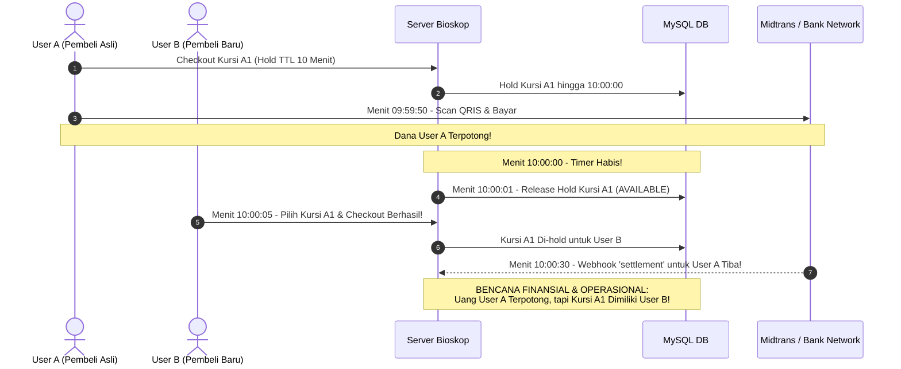
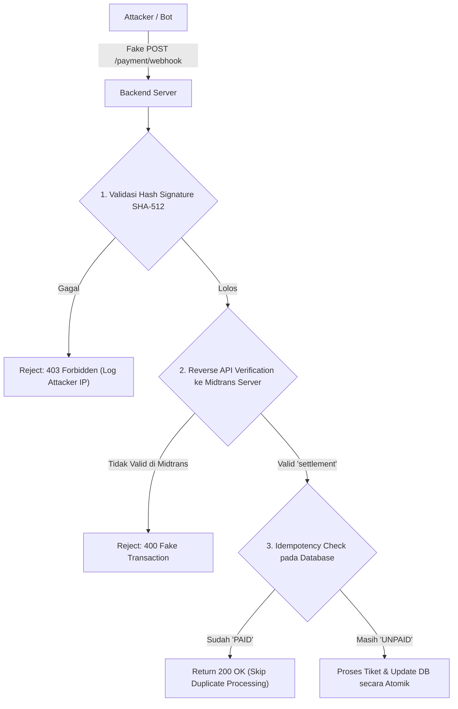
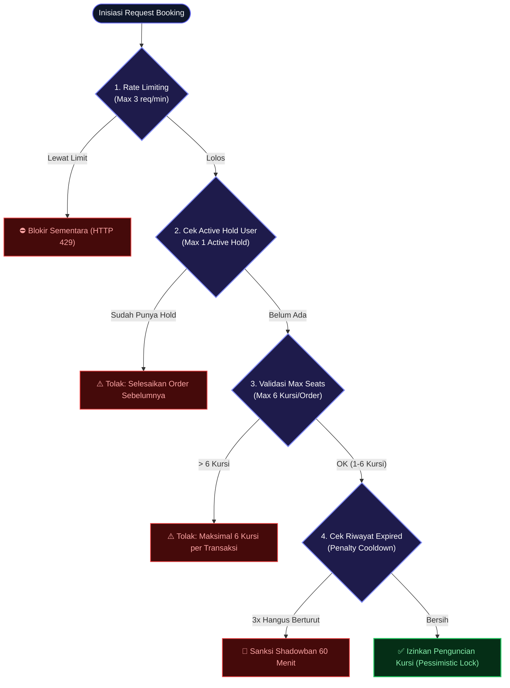

# BAB 7: CRITICAL SYSTEM AUDIT & MIDTRANS EDGE-CASES

---

Sebagai Lead Systems Architect & Concurrency Engineering Specialist, bab ini membongkar secara brutal potensi kegagalan tersembunyi, celah logika, dan anomali jaringan pada sistem transaksi tiket bioskop dengan integrasi payment gateway Midtrans.

---

## 7.1 Cacat 1: Dilema "Pembayaran Sukses di Detik Terakhir vs Webhook Terlambat"

### Kronologi Anomali & Konflik Finansial (Anatomy of Disaster)



### Analisis Akar Masalah (Root Cause):
Jaringan perbankan (khususnya *switching* BI-FAST, QRIS inter-bank, atau core banking settlement) memiliki fluktuasi latensi asinkron berkisar antara 2 hingga 45 detik. Jika batas kedaluwarsa payment gateway sama persis dengan batas database lokal, maka pembeli yang membayar di detik-detik terakhir dijamin akan mengalami sengketa finansial karena kursinya keburu di-release ke penonton lain.

---

### Solusi Arsitektur & Mitigasi Berlapis:

1. **Mitigasi Preventif: Asymmetric Expiry Window (Wajib):**  
   - TTL Kursi di Database: **10 Menit (600 Detik)**.
   - Parameter `custom_expiry` di Snap API Midtrans: **9 Menit (540 Detik)**.
   - Dampak: Midtrans mematikan transaksi pada menit ke-09:00. Pembayaran di detik terakhir dicegah secara dini di gerbang Midtrans. Jeda 60 detik dialokasikan untuk pemrosesan webhook yang tertunda.
2. **Mitigasi Detektif: Hold Grace Period (Toleransi 60 Detik):**  
   Kueri pembebasan kursi (`RELEASED`) memberikan toleransi $t_{\text{grace}} = 60\text{s}$ bagi order yang sudah menerbitkan token Snap, sehingga kursi tidak langsung dilempar ke publik jika webhook sedang dalam perjalanan.
3. **Mitigasi Kuratif: Autonomous Auto-Refund Engine:**  
   Jika webhook `settlement` tiba dan verifikasi mendapati kursi sudah berstatus `BOOKED` atau di-hold oleh orang lain:
   - Sistem **DILARANG MENGUBAH ORDER JADI PAID** (Cegah Overbook).
   - Order ditandai sebagai `OVERBOOKED_REFUND_PENDING`.
   - Sistem memicu API Refund Midtrans secara otomatis atau memasukkan transaksi ke antrean kompensasi instan (Voucher VIP + Saldo Balik).

#### Pseudocode Mitigasi Webhook Settlement Conflict:
```php
// Di dalam transaksi DB PaymentWebhookController::handle()
$isSeatConflict = $db->query("
    SELECT COUNT(*) 
    FROM order_items oi
    JOIN orders o ON o.id = oi.order_id
    WHERE o.showtime_id = {$order['showtime_id']}
      AND oi.seat_id IN ($seatIdsList)
      AND o.status = 'PAID'
      AND o.id != {$order['id']}
")->fetchColumn() > 0;

if ($isSeatConflict) {
    // 1. Catat ke tabel audit log insiden kritis
    $db->prepare("
        INSERT INTO critical_incidents (order_id, issue_type, details, created_at)
        VALUES (?, 'OVERBOOK_LAST_SECOND', 'Kursi terlanjur dibeli user lain saat webhook settlement tiba.', NOW())
    ")->execute([$order['id']]);

    // 2. Set status order ke REFUNDED
    $db->prepare("UPDATE orders SET status = 'REFUNDED', cancelled_at = NOW() WHERE id = ?")->execute([$order['id']]);

    // 3. Panggil API Midtrans Refund Asinkron (untuk QRIS/GoPay)
    $this->triggerMidtransAutoRefund($orderNumber, $grossAmount, "Auto-refund: Bentrok overbook kursi.");

    $db->commit();
    return Response::json(['message' => 'Conflict resolved via auto-refund'], 200);
}
```

---

## 7.2 Cacat 2: Celah Pemalsuan Webhook (Spoofing & Replay Attack)

### Skenario Serangan:
- **Spoofing:** Attacker mengarahkan request POST palsu ke `/payment/webhook` dengan body `{"transaction_status": "settlement", "order_id": "NEXUS-..."}` untuk memicu penerbitan tiket bioskop secara cuma-cuma tanpa pernah membayar.
- **Replay Attack:** Attacker merekam request webhook sah dari masa lalu, kemudian menembakkannya kembali secara terus-menerus untuk memicu efek samping ganda pada database.



### Solusi Arsitektur & Mitigasi Konkret:

1. **Verifikasi Hash Kriptografis SHA-512 Wajib:**  
   $$\text{Signature} = \text{SHA512}(\text{order\_id} + \text{status\_code} + \text{gross\_amount} + \text{ServerKey})$$  
   Gunakan fungsi `hash_equals()` untuk menghindari serangan celah waktu (*Timing Attacks*).
2. **Reverse API Verification (Double Verification):**  
   Server tidak boleh 100% mempercayai data yang dikirim melalui HTTP POST publik. Setiap kali menerima status `settlement`, server melakukan *callback query* langsung ke Midtrans API:
   `GET https://api.midtrans.com/v2/{order_id}/status`  
   Jika respons resmi dari server Midtrans tidak berstatus `settlement`, request langsung dihentikan.
3. **Midtrans IP Whitelisting & Reverse Proxy Protection:**  
   Konfigurasi Nginx/Caddy untuk membatasi akses endpoint `/payment/webhook` hanya dari subnet resmi Midtrans (`103.208.23.0/24`).

---

## 7.3 Cacat 3: Race Condition & Deadlock MySQL pada `SELECT ... FOR UPDATE`

### Mekanisme Terjadinya Deadlock pada Lonjakan Tiket:

```mermaid
sequenceDiagram
    autonumber
    actor User1 as User 1 (Pilih Kursi A2, A1)
    actor User2 as User 2 (Pilih Kursi A1, A2)
    participant InnoDB as MySQL InnoDB Lock Manager

    User1->>InnoDB: Lock Kursi A2 (ID: 12) -> BERHASIL
    User2->>InnoDB: Lock Kursi A1 (ID: 11) -> BERHASIL
    User1->>InnoDB: Ingin Lock Kursi A1 (ID: 11) -> TERTAHAN (Menunggu User 2)
    User2->>InnoDB: Ingin Lock Kursi A2 (ID: 12) -> TERTAHAN (Menunggu User 1)
    Note over User1, InnoDB: SIKLUS SALING TUNGGU TERDETEKSI (DEADLOCK!)
    InnoDB-->>User2: Error 1213: Deadlock found when trying to get lock; try restarting transaction
```

### Solusi Arsitektur & Mitigasi Konkret:

1. **Kanonikal Sorting (Penyortiran ASC Mutlak):**  
   Array `seat_ids` wajib diurutkan secara menaik (*ascending*) sebelum kueri dieksekusi:
   ```php
   $seatIds = array_map('intval', $seatIds);
   sort($seatIds, SORT_NUMERIC); // [11, 12]
   ```
   Dengan urutan deterministik ini, User 1 dan User 2 akan sama-sama meminta kunci untuk ID 11 terlebih dahulu. User 2 akan langsung tertahan di kunci pertama sebelum memegang kunci kedua, sehingga **lingkaran dependensi saling tunggu (deadlock) mustahil terbentuk**.
2. **Pemisahan Panggilan API Eksternal dari Transaksi Database:**  
   Panggilan `curl_exec` ke Snap API Midtrans **HARUS DILETAKKAN SETELAH** database transaction selesai (`COMMIT`), atau baris dikunci dalam waktu seminimal mungkin ($< 5\text{ms}$). Menaruh HTTP cURL di dalam `BEGIN ... COMMIT` akan menyandera lock database selama ratusan milidetik dan membuat seluruh pool koneksi MySQL lumpuh (*Connection Pool Exhaustion*).
3. **Tuning Parameter InnoDB:**  
   ```sql
   SET innodb_lock_wait_timeout = 3; -- Mengurangi waktu tunggu lock dari default 50s ke 3s
   ```

---

## 7.4 Cacat 4: Abuse Penguncian Kursi (Troll Booking & Seat Hoarding)

### Skenario Serangan:
Pelaku (kompetitor bioskop atau bot calo) menulis skrip Python sederhana yang menembak endpoint `/checkout/create-transaction` secara berulang setiap 9 menit untuk mengunci seluruh kursi studio (200 kursi) tanpa pernah membayar. Akibatnya, calon penonton asli melihat studio penuh padahal bioskop sebenarnya kosong melompong.



### Solusi Arsitektur & Mitigasi Konkret:

1. **Batas Maksimal 1 Active Hold per Pengguna:**  
   Setiap user yang masih memiliki transaksi `UNPAID` dilarang membuka transaksi baru:
   ```sql
   SELECT COUNT(*) FROM orders 
   WHERE user_id = :user_id 
     AND status = 'UNPAID' 
     AND expires_at > NOW();
   ```
2. **Batas Maksimal Kursi per Transaksi:**  
   Dibatasi maksimal 6 kursi per satu order.
3. **Hukuman Akun Kadaluwarsa (Penalty Cooldown):**  
   Jika sebuah akun membiarkan transaksinya hangus (`EXPIRED`) sebanyak 3 kali berturut-turut dalam kurun waktu 24 jam, sistem otomatis menerapkan penangguhan (*shadowban*) pemesanan tiket selama 60 menit.
4. **Verifikasi Pra-Checkout:**  
   Wajibkan verifikasi nomor telepon (WhatsApp OTP) atau Google reCAPTCHA v3 sebelum user diizinkan memanggil endpoint penguncian kursi.

---

## 7.5 Matriks Evaluasi Mitigasi Arsitektur

| Potensi Cacat / Bug | Tingkat Dampak | Probabilitas Terjadi | Mekanisme Mitigasi Arsitektur |
| :--- | :--- | :--- | :--- |
| **Last-Second Settlement vs Webhook Delay** | **CRITICAL (Finansial)** | Tinggi saat film blockbuster | Asymmetric Expiry Window (Snap 9m, DB 10m), Hold Grace Period, Autonomous Midtrans Refund API. |
| **Webhook Spoofing & Replay Attack** | **HIGH (Keamanan)** | Menengah (Target Bot) | Timing-safe Signature SHA-512, Reverse Verification `GET /v2/{order_id}/status`, Idempotency Key Guard. |
| **MySQL Lock Deadlock (1213 Error)** | **HIGH (Ketersediaan)** | Sangat Tinggi saat tiket rilis | Kanonikal Sorting ASC (`ORDER BY id ASC`), Pindahkan HTTP cURL Snap keluar dari DB Transaction. |
| **Troll Booking & Seat Hoarding** | **MEDIUM (Operasional)** | Tinggi | Batas 1 Active Hold per user, Maksimal 6 kursi, Cooldown Penalty Box, Validasi OTP/CAPTCHA. |
