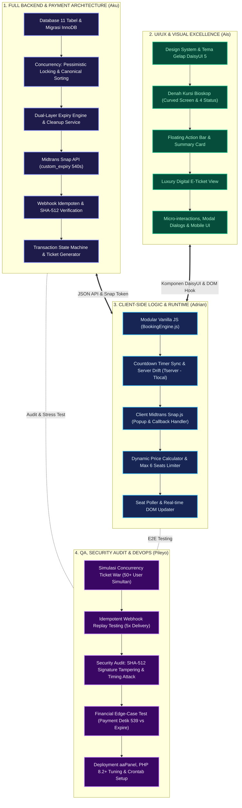

# BAB 8: PEMBAGIAN JOBDESK & ROADMAP TIM TEKNIS

---

## 👥 STRUKTUR TIM PENGEMBANG (4 ORANG)

Sistem *Cinema Ticketing & Real-Time Seat Booking Engine* dikembangkan oleh tim lintas disiplin yang terdiri dari 4 anggota dengan pembagian peran yang fokus, spesifik, dan saling terintegrasi:

| No | Anggota | Peran / Spesialisasi Utama | Fokus Area & Tanggung Jawab Inti |
| :---: | :--- | :--- | :--- |
| 1 | **Aku** | **Lead Backend Architect & Payment Integration Engineer** | **100% Seluruh Backend:** Skema Database 11 Tabel InnoDB, Concurrency Engine (*Pessimistic Locking* & *Canonical Sorting*), Dual-Layer Expiry Service, Integrasi Midtrans Snap API, Webhook Idempoten & Verifikasi SHA-512, serta State Machine Transaksi. |
| 2 | **Ais** | **Lead UI/UX & Frontend Design Specialist** | **Seluruh Tampilan Visual & Desain:** Design System DaisyUI 5, Tipografi & Palet Warna Mewah, Denah Kursi Bioskop Interaktif (*Curved Screen* & 4 Status Visual), Floating Summary Card, Luxury E-Ticket View, serta Responsivitas Mobile/Desktop. |
| 3 | **Adrian** | **Frontend Client Logic & Interactive Runtime Engineer** | **Logika Interaktif Browser:** Modular Vanilla JS (`BookingEngine.js`), Sinkronisasi Timer Presisi & Drift Jam Server, Integrasi `window.snap.pay`, Polling Ketersediaan Kursi, Dynamic Price Calculator, dan DOM Event Handler. |
| 4 | **Pileyo** | **Quality Assurance (QA), Security Auditing & DevOps Engineer** | **Pengujian Sistem & Keandalan Operasional:** Stress Test Konkurensi (*Ticket War* Anti-Double-Booking), Uji Replay Webhook Idempoten, Audit Keamanan Signature SHA-512, Skenario Edge-Case Finansial, serta Deployment Server & Crontab Setup. |

---

## 📌 MATRIKS TANGGUNG JAWAB & ARSITEKTUR KERJA



---

## 1. 🛠️ AKU — Lead Backend Architect & Payment Integration Engineer

Memegang tanggung jawab penuh atas **100% sisi backend aplikasi**: skema database, proteksi race condition, seluruh endpoint API, integrasi Midtrans, penanganan webhook kriptografis, dan orkestrasi transaksi.

### Sub-Task & Checklist Pelaksanaan:

#### A. Database Architecture & Migrations (Bab 2)
- [ ] Menyusun berkas migrasi 11 tabel relasional InnoDB dengan strict types (`declare(strict_types=1);`):
  - [ ] Tabel master: `cinemas`, `studios`, `seats`, `movies`, `showtimes`, `pricing_tiers`, `users`.
  - [ ] Tabel transaksional: `orders`, `order_items`, `seat_holds`, `payment_logs`, `tickets`.
- [ ] Menambahkan *Composite Indexes* berkinerja tinggi:
  - [ ] `showtimes(movie_id, studio_id, start_time)`
  - [ ] `seat_holds(showtime_id, seat_id, status)`
  - [ ] `order_items(order_id, seat_id)`
- [ ] Menegakkan integritas referensial: `FOREIGN KEY` dengan aturan `ON DELETE CASCADE / RESTRICT` yang tepat.
- [ ] Menerapkan aturan integritas kardinalitas: Dilarang keras menaruh kolom status `LOCKED/BOOKED` langsung pada tabel master `seats`.

#### B. Concurrency Control & Anti-Deadlock Locking Engine (Bab 4)
- [ ] Mengimplementasikan *Canonical Sorting Order* (`seat_ids ASC`) sebelum membuka transaksi MySQL untuk meniadakan siklus *Deadlock* (`InnoDB Error 1213`).
- [ ] Menulis query penguncian baris eksplisit: `SELECT * FROM seats WHERE id IN (...) ORDER BY id ASC FOR UPDATE`.
- [ ] Melakukan pengecekan ganda (*Double-check conflict*):
  - [ ] Validasi bahwa kursi belum berstatus `PAID` pada `order_items`.
  - [ ] Validasi bahwa kursi tidak memiliki hold aktif yang belum kedaluwarsa pada `seat_holds`.
- [ ] Mengonfigurasi parameter transaksi: `SET innodb_lock_wait_timeout = 3` guna memotong antrean transaksi yang tertahan.

#### C. Dual-Layer Expiry Service & Scheduled Cleanup (Bab 4)
- [ ] Menetapkan masa berlaku hold kursi di database lokal tepat **10 Menit (600 Detik)** pada `seat_holds.expires_at`.
- [ ] Membangun *Lazy Expiry Checker* yang otomatis mengabaikan hold kedaluwarsa saat query baca ketersediaan kursi.
- [ ] Membangun CLI command / scheduler: `php nexus seats:cleanup` untuk menyapu record hold kedaluwarsa secara berkala.
- [ ] Memastikan *Asymmetric Expiry Buffer*: Hold database lokal (600 detik) bertahan 60 detik lebih lama dari gateway Midtrans (540 detik).

#### D. Midtrans Snap API Server-Side Engine (Bab 1 & Bab 5)
- [ ] Mengembangkan Service `MidtransService` untuk komunikasi HTTP aman ke endpoint Midtrans (`/snap/v1/transactions`).
- [ ] Menyuntikkan parameter krusial `custom_expiry: { expiry_duration: 9, unit: 'minute' }` (540 detik) pada request Snap.
- [ ] Membentuk payload transaksi Midtrans: `transaction_details`, `item_details`, `customer_details`, dan `expiry`.
- [ ] Mengembalikan response `snap_token` dan `redirect_url` ke controller.

#### E. Webhook Controller Idempoten & Kriptografi Signature SHA-512 (Bab 5)
- [ ] Membangun endpoint `POST /payment/webhook` penerima notifikasi HTTP dari Midtrans.
- [ ] Memvalidasi *Signature Key* kriptografis SHA-512:
  $$\text{Signature} = \text{hash}('sha512', \text{order\_id} + \text{status\_code} + \text{gross\_amount} + \text{ServerKey})$$
- [ ] Menggunakan fungsi `hash_equals()` anti-*timing attack*. Menolak request dengan HTTP 403 jika signature tidak sah.
- [ ] Menerapkan **Idempotency Guard**: Jika `orders.status` sudah `PAID`, webhook susulan langsung mengembalikan HTTP 200 tanpa duplikasi pembuatan tiket.
- [ ] Menyimpan seluruh payload raw webhook ke tabel `payment_logs` untuk audit jejak digital.

#### F. State Machine & Order Status Transition Engine (Bab 3)
- [ ] Memetakan notifikasi Midtrans (`settlement`, `capture`, `pending`, `deny`, `expire`, `cancel`) ke status internal `orders`.
- [ ] Logika Sukses (`PAID`): Ubah status `orders` menjadi `PAID`, ubah `seat_holds` menjadi `CONVERTED`, dan terbitkan record ke tabel `tickets`.
- [ ] Logika Gagal/Batal (`CANCELLED` / `EXPIRED`): Ubah `orders` menjadi `EXPIRED`, ubah status `seat_holds` menjadi `RELEASED` agar kursi langsung dapat dipesan orang lain.
- [ ] Validasi input ketat dengan FormRequest (`CheckoutRequest`) menggunakan `declare(strict_types=1);`.

---

## 2. 🎨 AIS — Lead UI/UX & Frontend Design Specialist

Bertanggung jawab penuh atas **seluruh aspek visual, antarmuka, estetika, dan tata letak halaman**: memastikan desain terlihat mewah (*luxury cinema feel*), menggunakan komponen DaisyUI 5, dan ramah pengguna di semua ukuran layar.

### Sub-Task & Checklist Pelaksanaan:

#### A. Design System & DaisyUI 5 Theming (Bab 6)
- [ ] Mengonfigurasi tema gelap modern (*Dark Luxury Cinema Palette*) berbasis Tailwind CSS & DaisyUI 5.
- [ ] Mengintegrasikan tipografi Google Fonts modern (*Plus Jakarta Sans* untuk UI umum, *JetBrains Mono* untuk timer, kode booking, dan harga).
- [ ] Menstandarisasi komponen DaisyUI di seluruh halaman: `btn`, `card`, `badge`, `modal`, `alert`, `stats`, `fieldset`, `breadcrumbs`.
- [ ] Menegakkan aturan proyek: Tidak ada komponen native mentah tanpa styling DaisyUI & tidak ada inline SVG mentah (gunakan Lucide Icons `<i data-lucide="...">`).

#### B. Denah Kursi Bioskop Interaktif (*Interactive Seating Grid*)
- [ ] Merancang visual Layar Bioskop (*Curved Cinema Screen Arc*) dengan aksen gradasi glow lengkung yang elegan.
- [ ] Membangun denah grid kursi studio (Baris A s/d G, Nomor 1 s/d 14) dengan 4 status visual yang jelas:
  - [ ] **Available (Tersedia):** `btn-outline btn-neutral` dengan transisi hover halus.
  - [ ] **Selected (Dipilih Pengguna):** `btn-primary shadow-lg scale-105` bersinar terang.
  - [ ] **Held by Other (Sedang Di-hold Orang Lain):** `btn-warning cursor-not-allowed opacity-75`.
  - [ ] **Sold / Booked (Terjual):** `btn-error btn-disabled opacity-40`.
- [ ] Merancang Legenda Status Kursi (*Seating Legend Bar*) yang bersih dan mudah dipahami di bagian bawah denah.
- [ ] Merancang tata letak lorong bioskop (*aisle gap*) dan penomoran baris yang tetap rapi pada layar smartphone kecil.

#### C. Katalog Film, Floating Summary Bar & Luxury E-Ticket View
- [ ] **Katalog Film & Jadwal:** Card poster film beresolusi tinggi, badge rating umur (`SU`, `13+`, `17+`), info studio, dan pilihan slot waktu tayang.
- [ ] **Floating Checkout Summary Bar:** Bar melayang di bagian bawah layar yang merangkum kursi yang dipilih, kalkulasi total biaya, dan tombol aksi `Lanjut Pembayaran`.
- [ ] **Luxury Digital E-Ticket View:** Desain tiket bioskop digital dengan layout elegan: judul film, studio badge, tanggal & jam tayang, deretan nomor kursi, Order ID, serta Barcode / QR Code siap-scan di pintu bioskop.
- [ ] **Modal Dialogs & Feedback Alerts:** Desain modal DaisyUI untuk konfirmasi order, peringatan waktu hold tersisa sedikit, modal *Waktu Habis*, dan pesan error ramah pengguna.

---

## 3. ⚡ ADRIAN — Frontend Client Logic & Interactive Runtime Engineer

Bertanggung jawab penuh atas **seluruh logika JavaScript modular di sisi browser**: interaksi pengguna, kalkulasi dinamis, sinkronisasi jam server, integrasi popup pembayaran Midtrans Snap.js, dan pembaruan visual secara real-time.

### Sub-Task & Checklist Pelaksanaan:

#### A. Modular Client JavaScript Engine (`resources/js/modules/booking.js`)
- [ ] Mengembangkan modul Vanilla JS terstruktur tanpa framework berat (React/Vue/Svelte dilarang sesuai aturan proyek).
- [ ] Mengelola state lokal kursi:
  - [ ] Simpan daftar kursi aktif yang diklik pengguna.
  - [ ] Batasi pemilihan maksimal 6 kursi per sesi checkout untuk mencegah *seat hoarding*.
- [ ] Dynamic Price Calculator: Hitung ulang subtotal, biaya layanan, dan grand total secara instan saat kursi dipilih/dibatalkan.
- [ ] Mengikat interaksi DOM denah buatan Ais dengan state JavaScript (toggle styling kelas DaisyUI saat klik).

#### B. Countdown Timer Presisi & Sinkronisasi Drift Jam Server (Bab 6)
- [ ] Menangkap timestamp kedaluwarsa dari respons server (`expires_at_unix`).
- [ ] Mengimplementasikan formula kompensasi perbedaan jam perangkat klien vs server (*clock drift compensation*):
  $$\Delta_{\text{drift}} = T_{\text{server}} - T_{\text{local\_client}}$$
  $$T_{\text{target}} = \text{expires\_at\_unix} - \Delta_{\text{drift}}$$
- [ ] Menjalankan interval countdown timer 10:00 $\rightarrow$ 00:00 yang akurat hingga per milidetik.
- [ ] Trigger otomatis saat timer habis (00:00):
  - [ ] Kunci tombol pembayaran dan form.
  - [ ] Tampilkan modal DaisyUI pemberitahuan *Waktu Pembayaran Habis*.
  - [ ] Picu pembaruan status denah kursi agar kursi kembali berstatus *Available*.

#### C. Integrasi Client-Side Midtrans Snap.js (Bab 6)
- [ ] Memuat script resmi SDK Midtrans Snap (`snap.js`) dengan Client Key sandbox/production.
- [ ] Mengirimkan request AJAX / Fetch API `POST /checkout/create-transaction` dengan CSRF token aman.
- [ ] Memunculkan modal popup Snap: `window.snap.pay(snapToken, callbacks)`.
- [ ] Menangani callback Midtrans secara lengkap:
  - [ ] `onSuccess(result)`: Redirect ke halaman E-Ticket dengan notifikasi sukses.
  - [ ] `onPending(result)`: Tampilkan instruksi pembayaran nomor VA / QRIS.
  - [ ] `onError(result)`: Tampilkan pesan kegagalan dan berikan opsi coba ulang.
  - [ ] `onClose()`: Pertahankan timer hold kursi selama sisa waktu 10 menit masih ada.

#### D. Real-Time Seat Poller
- [ ] Mengembangkan mekanisme polling background ringan (misal: setiap 15–30 detik) ke endpoint cek status kursi.
- [ ] Memperbarui status kursi yang baru saja di-hold atau dibeli oleh pengguna lain tanpa me-refresh seluruh halaman.

---

## 4. 🛡️ PILEYO — Quality Assurance (QA), Security Auditing & DevOps Engineer

Bertanggung jawab penuh atas **keandalan sistem, pengujian beban konkurensi ekstrem (*ticket war*), audit keamanan transaksi, dan orkestrasi deployment server**.

### Sub-Task & Checklist Pelaksanaan:

#### A. Concurrency & Race Condition Stress Testing (*Ticket War Audit*)
- [ ] Menyusun script automated test (menggunakan cURL / k6 / JMeter) untuk menyimulasikan 50+ request simultan yang menembak 1 kursi yang sama di milidetik identik.
- [ ] Memverifikasi jaminan *Zero Double-Booking*:
  - [ ] Tepat 1 request berhasil mendapatkan kursi (HTTP 200/201).
  - [ ] Sisa 49 request lainnya tertolak secara konsisten dengan HTTP 409 Conflict tanpa menyebabkan *Deadlock Crash* pada MySQL.
- [ ] Menguji efektivitas *Canonical Sorting Order* di bawah beban transaksi acak (misal user A memilih kursi [1, 2], user B memilih [2, 1]).

#### B. Idempotency & Webhook Replay Attack Testing (Bab 5 & Bab 7)
- [ ] Menembakkan payload webhook pembayaran yang sama sebanyak 5 kali berturut-turut.
- [ ] Memverifikasi bahwa sistem hanya menerbitkan tepat 1 tiket dan tidak menduplikasi record pada database (*Idempotent Test*).
- [ ] Menguji skenario notifikasi out-of-order: Memverifikasi sistem tidak membalikkan status `PAID` kembali ke `PENDING` jika webhook lama tiba terlambat.

#### C. Security Auditing & Signature Verification Test
- [ ] Menguji manipulasi payload: Mengubah `gross_amount` atau `order_id` pada webhook dan memverifikasi penolakan instan dengan HTTP 403 Forbidden.
- [ ] Mengaudit keamanan header webhook dan memastikan tidak ada informasi sensitif (seperti Server Key) yang bocor ke log publik.
- [ ] Memastikan seluruh input endpoint terlindungi dari serangan SQL Injection dan XSS.

#### D. Skenario Uji Finansial Ekstrem (Bab 7)
- [ ] **Late Payment Edge-Case:** Menyimulasikan pengguna membayar di detik ke-539, namun notifikasi webhook baru masuk di detik ke-610 (setelah database hold kedaluwarsa).
- [ ] Memvalidasi pemicu *Auto-Refund Engine* atau flag investigasi admin untuk menangani selisih kas.

#### E. Server Deployment, Environment & Crontab Setup
- [ ] Mengonfigurasi lingkungan server aaPanel: PHP 8.2+ dengan ekstensi `pdo_mysql`, `bcmath`, `curl`, `mbstring`.
- [ ] Menyiapkan cronjob server untuk menjalankan pembersihan hold kursi kedaluwarsa:
  ```bash
  * * * * * cd /home/Akuma/projects/mvc && php nexus seats:cleanup >> /dev/null 2>&1
  ```
- [ ] Mengonfigurasi symlink direktori storage: `php nexus storage:link`.
- [ ] Mengatur Cloudflare Tunnel / SSL reverse proxy untuk memastikan webhook Midtrans dapat menjangkau server dengan HTTPS valid.

---

## 📅 TIMELINE INTEGRASI & TAHAPAN KERJA (MILESTONES)

```mermaid
flowchart LR
    subgraph F1["📌 FASE 1: FONDASI ARSITEKTUR & UI SYSTEM"]
        direction TB
        F1_A["<b>1. Database & Concurrency Core</b><br/>• Skema 11 Tabel InnoDB & Indexes<br/>• Pessimistic Locking & Canonical Sorting<br/><i>PIC: Aku (Target: 3 Hari)</i>"]
        F1_B["<b>2. Design System & Interactive Seating</b><br/>• Tema DaisyUI 5 & Curved Screen Arc<br/>• Denah Kursi Bioskop 4 Status Visual<br/><i>PIC: Ais (Target: 4 Hari)</i>"]
    end

    subgraph F2["⚡ FASE 2: INTEGRASI CORE BACKEND & CLIENT JS"]
        direction TB
        F2_A["<b>3. Midtrans API & Webhook Engine</b><br/>• Snap API (custom_expiry 540s)<br/>• Webhook Idempoten & SHA-512<br/><i>PIC: Aku (Target: 3 Hari)</i>"]
        F2_B["<b>4. Modular JS & Timer Sync</b><br/>• BookingEngine.js & Timer Drift Sync<br/>• Popup Snap.js & Event Callbacks<br/><i>PIC: Adrian (Target: 4 Hari)</i>"]
    end

    subgraph F3["🛡️ FASE 3: END-TO-END QA & DEPLOYMENT"]
        direction TB
        F3_A["<b>5. Integrasi Sistem & UI Hook</b><br/>• E2E Flow: Katalog -> Seat -> Snap -> Ticket<br/><i>PIC: Aku, Ais & Adrian (Target: 2 Hari)</i>"]
        F3_B["<b>6. Stress Test & Security Audit</b><br/>• Concurrency Ticket War (50+ User)<br/>• Webhook Replay & Financial Edge-Cases<br/><i>PIC: Pileyo (Target: 3 Hari)</i>"]
        F3_C["🚀 <b>7. Peluncuran Produksi (v1.0-PROD)</b><br/>• Deploy aaPanel, SSL Tunnel & Crontab Cleanup<br/><i>PIC: Pileyo & Seluruh Tim</i>"]
    end

    F1 ==>|Fondasi DB & Desain Siap| F2
    F2 ==>|API & Client Logic Terhubung| F3

    classDef default fill:#0f172a,stroke:#6366f1,stroke-width:1.5px,color:#f8fafc;
    classDef f1 fill:#0b1329,stroke:#38bdf8,stroke-width:2px,color:#f0f9ff;
    classDef f2 fill:#130e2e,stroke:#a855f7,stroke-width:2px,color:#faf5ff;
    classDef f3 fill:#062319,stroke:#10b981,stroke-width:2px,color:#ecfdf5;
    classDef nodeBox fill:#1e293b,stroke:#475569,stroke-width:1.5px,color:#e2e8f0;
    classDef milestone fill:#064e3b,stroke:#34d399,stroke-width:2px,color:#ffffff;

    class F1 f1;
    class F2 f2;
    class F3 f3;
    class F1_A,F1_B,F2_A,F2_B,F3_A,F3_B nodeBox;
    class F3_C milestone;
```



| Fase | Target Luaran (Deliverables) | Penanggung Jawab Utama |
| :--- | :--- | :--- |
| **Fase 1: Fondasi & Desain** | Skema 11 tabel InnoDB siap, Pessimistic Lock teruji, Design System DaisyUI 5 selesai, denah visual kursi siap pakai. | **Aku** (DB & Concurrency) & **Ais** (UI/UX) |
| **Fase 2: Integrasi & Logika** | Snap Token (custom_expiry 540s) terbit, Webhook idempoten tervalidasi SHA-512, Modular Vanilla JS & Countdown Timer aktif. | **Aku** (Full Backend) & **Adrian** (Client JS) |
| **Fase 3: Pengujian & Rilis** | Alur end-to-end tervalidasi, lolos uji stres konkurensi *ticket war*, aman dari *replay attack*, cronjob aktif di server. | **Pileyo** (QA & DevOps) & **Seluruh Tim** |
