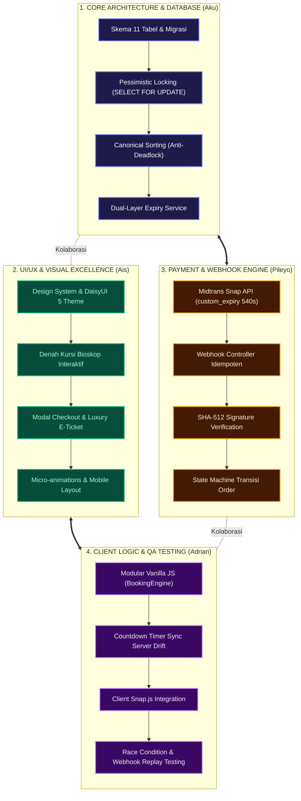
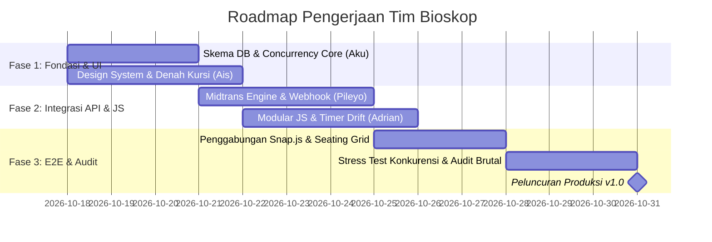

# BAB 8: PEMBAGIAN JOBDESK & ROADMAP TIM TEKNIS

---

## 👥 STRUKTUR TIM PENGEMBANG (4 ORANG)

Sistem *Cinema Ticketing & Real-Time Seat Booking Engine* dikembangkan oleh tim lintas disiplin yang terdiri dari 4 anggota dengan pembagian peran yang fokus, spesifik, dan saling terintegrasi:

| No | Anggota | Peran / Spesialisasi Utama | Fokus Area & Tanggung Jawab Inti |
| :---: | :--- | :--- | :--- |
| 1 | **Aku** | **Tech Lead & Core Backend / Database Architect** | Arsitektur MVC, Skema Database 11 Tabel, Concurrency Engine (Pessimistic Locking & Canonical Sorting), Dual-Layer Expiry Lifecycle. |
| 2 | **Ais** | **Lead UI/UX & Frontend Design Specialist** | Design System, Komponen DaisyUI 5, Denah Kursi Interaktif (Seating Grid), Layout Halaman, E-Ticket View, Visual Aesthetics & Micro-interactions. |
| 3 | **Pileyo** | **Backend Integration & Payment Gateway Specialist** | Midtrans Snap API Engine, Webhook Idempoten & SHA-512 Signature, State Machine Status Transaksi, Form Request & Validasi. |
| 4 | **Adrian** | **Frontend Client Logic, Real-Time Engine & QA Specialist** | Modular Vanilla JS (`BookingEngine`), Sinkronisasi Timer & Drift Jam Server, Integrasi `window.snap.pay`, Polling Kursi, Simulasi Race Condition & Testing. |

---

## 📌 MATRIKS TANGGUNG JAWAB & SUB-TASK DETAIL

---

## 1. 🛠️ AKU — Tech Lead & Core Backend / Database Architect

Bertanggung jawab penuh atas fondasi sistem, integritas data, mitigasi konkurensi ekstrem, dan orkestrasi arsitektur Clean MVC.

### Sub-Task & Checklist Pelaksanaan:

#### A. Database Schema & Migration Engine (Bab 2)
- [ ] Menyusun file migrasi untuk 11 tabel relasional InnoDB (`cinemas`, `studios`, `seats`, `movies`, `showtimes`, `orders`, `order_items`, `seat_holds`, `payments`, `tickets`, `users`).
- [ ] Mengonfigurasi *composite index* performa tinggi pada `showtimes(movie_id, studio_id, start_time)` dan `seat_holds(showtime_id, seat_id, status)`.
- [ ] Menegakkan aturan integritas referensial: `FOREIGN KEY` dengan `ON DELETE CASCADE / RESTRICT` yang presisi.
- [ ] Menerapkan aturan arsitektur: Dilarang keras menambahkan kolom status `LOCKED/BOOKED` langsung pada master tabel `seats` (pelanggaran kardinalitas).

#### B. Concurrency Control & Pessimistic Locking (Bab 4)
- [ ] Mengimplementasikan *Canonical Sorting* (`seat_ids ASC`) sebelum membuka transaksi database untuk mengeliminasi risiko siklus *Deadlock* MySQL (`Error 1213`).
- [ ] Menulis query penguncian baris eksplisit: `SELECT * FROM seats WHERE id IN (...) ORDER BY id ASC FOR UPDATE`.
- [ ] Membangun pengecekan ganda (*Double-check conflict*): Validasi bahwa tidak ada kursi yang berstatus `PAID` pada `order_items` atau `HELD` aktif pada `seat_holds`.
- [ ] Mengonfigurasi parameter transaksi database: `SET innodb_lock_wait_timeout = 3` untuk mencegah antrean transaksi menggantung.

#### C. Dual-Layer Expiry Service & Lifecycle Cleanup (Bab 4 & Bab 7)
- [ ] Mengatur masa berlaku hold lokal tepat **10 Menit (600 Detik)** pada kolom `seat_holds.expires_at`.
- [ ] Membangun *Lazy Expiry Checker* pada saat query ketersediaan kursi dibaca.
- [ ] Membangun perintah CLI / Cron job background: `php nexus seats:cleanup` untuk menyapu hold basi yang ditinggalkan pengguna.
- [ ] Mengimplementasikan *Asymmetric Expiry Window*: Memastikan database hold (600s) memiliki *Safety Buffer* 60 detik lebih lama dari gateway Midtrans (540s).

---

## 2. 🎨 AIS — Lead UI/UX & Frontend Design Specialist

Bertanggung jawab penuh atas seluruh aspek antarmuka, tata letak visual, pengalaman pengguna (UX), keselarasan tema DaisyUI 5, denah kursi interaktif yang responsif, dan tampilan tiket digital.

### Sub-Task & Checklist Pelaksanaan:

#### A. Design System & DaisyUI 5 Theming (Bab 6)
- [ ] Merancang tema gelap (*Dark Cinema Theme*) menggunakan warna harmonis HSL/Tailwind dan komponen resmi DaisyUI 5.
- [ ] Mengonfigurasi tipografi modern via Google Fonts (*Plus Jakarta Sans* untuk UI, *JetBrains Mono* untuk timer & kode booking).
- [ ] Menstandarisasi komponen DaisyUI di seluruh halaman: `btn`, `card`, `badge`, `modal`, `alert`, `stats`, `fieldset`, `breadcrumbs`.
- [ ] Meniadakan penggunaan tombol/komponen native mentah tanpa styling DaisyUI (sesuai aturan proyek).

#### B. Denah Kursi Bioskop Interaktif (Interactive Seating Grid)
- [ ] Merancang visual Layar Bioskop (*Screen Arc*) dengan efek gradient pencahayaan lengkung yang realistis.
- [ ] Membangun matriks visual kursi bioskop (Baris A s/d G, Nomor 1 s/d 14) dengan 4 status visual kontras:
  - [ ] **Available (Tersedia):** `btn-outline btn-neutral` dengan transisi hover halus.
  - [ ] **Selected (Dipilih Pengguna):** `btn-primary shadow-lg scale-105` bersinar.
  - [ ] **Held by Other (Sedang Di-hold Orang Lain):** `btn-warning cursor-not-allowed opacity-75`.
  - [ ] **Sold / Booked (Terjual):** `btn-error btn-disabled opacity-40`.
- [ ] Merancang komponen Legenda Status Kursi (*Seating Legend Bar*) yang informatif di bagian bawah denah.
- [ ] Menambahkan indikator lorong bioskop (*aisle gap*) dan penomoran baris yang proporsional di perangkat mobile & desktop.

#### C. Layout Halaman & Tiket Digital (Luxury E-Ticket)
- [ ] Merancang Halaman Beranda / Katalog Film: Card poster film berestetika tinggi, badge rating usia (`SU`, `13+`, `17+`), info studio, dan jadwal jam tayang.
- [ ] Merancang Bar Aksi Bawah (*Floating Checkout Summary Bar*): Ringkasan kursi yang dipilih, total harga dinamis, dan tombol `Lanjut ke Pembayaran`.
- [ ] Merancang Halaman / Kartu Tiket Digital Mewah (*Luxury E-Ticket View*): Menampilkan Order Number, Barcode / QR Code SVG, Info Studio, Baris Kursi, dan Jam Tayang dengan desain elegan siap-cetak / siap-tunjuk di pintu bioskop.
- [ ] Merancang komponen Modal Dialog konfirmasi pembatalan dan notifikasi alert error yang ramah pengguna.

---

## 3. 💳 PILEYO — Backend Integration & Payment Gateway Specialist

Bertanggung jawab penuh atas integrasi gateway pembayaran Midtrans Snap & Core API, validasi data formulir, penanganan webhook idempoten, dan orkestrasi mesin status transaksi.

### Sub-Task & Checklist Pelaksanaan:

#### A. Integrasi Midtrans Snap API Engine (Bab 1 & Bab 5)
- [ ] Mengimplementasikan Service `MidtransService` untuk komunikasi HTTP ke endpoint Midtrans Snap (`/snap/v1/transactions`).
- [ ] Mengonfigurasi parameter krusial `custom_expiry`: Menutup batas bayar Midtrans di detik ke-540 (9 Menit) guna mengamankan *Safety Buffer* 60 detik.
- [ ] Menyusun payload JSON transaksi Midtrans secara lengkap: `transaction_details`, `item_details`, `customer_details`, dan `expiry`.
- [ ] Menghandle response Snap Token (`token`) dan redirect URL untuk dikirimkan kembali ke client.

#### B. Webhook Controller Idempoten & Kriptografi Signature SHA-512 (Bab 5)
- [ ] Membuat endpoint webhook resmi: `POST /payment/webhook` yang siap menerima *notification payload* dari Midtrans.
- [ ] Mengimplementasikan verifikasi signature kriptografis wajib:
  $$\text{Signature} = \text{hash}('sha512', \text{order\_id} + \text{status\_code} + \text{gross\_amount} + \text{ServerKey})$$
- [ ] Menerapkan pengecekan `hash_equals()` anti-*timing attack*. Menolak request dengan HTTP 403 jika signature tidak valid.
- [ ] Menerapkan **Idempotent Handler**: Jika order sudah berstatus `PAID`, webhook susulan wajib langsung mereturn HTTP 200 tanpa mengeksekusi duplikasi saldo atau tiket ganda.

#### C. State Machine & Lifecycle Transaksi (Bab 3)
- [ ] Memetakan seluruh kombinasi status Midtrans (`settlement`, `capture:accept`, `pending`, `expire`, `cancel`, `deny`) ke dalam status internal `orders` dan `seat_holds`.
- [ ] Menulis logika konversi otomatis: Ketika status `PAID`, ubah `seat_holds.status` menjadi `CONVERTED` dan entri record baru ke tabel `tickets`.
- [ ] Menulis logika pelepasan otomatis: Ketika status `EXPIRED` atau `CANCELLED`, ubah `seat_holds.status` menjadi `RELEASED` agar kursi langsung kembali `AVAILABLE`.
- [ ] Mengimplementasikan FormRequest validation (`CheckoutRequest`) dengan strict types pada input payload pengguna.

---

## 4. ⚡ ADRIAN — Frontend Client Logic, Real-Time Engine & QA Specialist

Bertanggung jawab penuh atas logika JavaScript modular di sisi browser, sinkronisasi jam client dengan server, integrasi popup Midtrans Snap.js, pembaruan ketersediaan kursi secara dinamis, serta pengujian kualitas sistem secara brutal (*chaos testing*).

### Sub-Task & Checklist Pelaksanaan:

#### A. Modular Client JavaScript Engine (Bab 6)
- [ ] Mengembangkan modul Vanilla JS terpisah di `resources/js/modules/booking.js` tanpa framework berat (sesuai aturan proyek).
- [ ] Mengelola state kursi lokal (*local selected seats state*): Batasi maksimal 6 kursi per satu transaksi untuk mencegah *seat hoarding*.
- [ ] Mengikat event klik interaktif pada denah kursi buatan Ais: Toggle class visual dan update nilai total harga secara instan.
- [ ] Mengirimkan request AJAX `POST /checkout/create-transaction` dengan payload JSON dan CSRF Token yang aman.

#### B. Countdown Timer Presisi & Sinkronisasi Jam Server (Bab 6)
- [ ] Menerima timestamp kadaluwarsa dari respons server (`expires_at_unix`).
- [ ] Menghitung kompensasi perbedaan jam perangkat pengguna dengan server (*clock drift compensation*):
  $$\Delta_{\text{drift}} = T_{\text{server}} - T_{\text{local\_client}}$$
- [ ] Menjalankan visual countdown timer 10:00 $\rightarrow$ 00:00 yang akurat hingga satuan detik.
- [ ] Membangun trigger auto-cancel: Begitu waktu habis, nonaktifkan form checkout, tampilkan modal *Waktu Habis*, dan refresh status kursi.

#### C. Integrasi Client Snap.js & Event Handlers (Bab 6)
- [ ] Memuat script SDK resmi Midtrans Snap (`snap.js`) dengan data attribute client key yang tepat.
- [ ] Memanggil popup pembayaran: `window.snap.pay(snapToken, callbacks)`.
- [ ] Mengimplementasikan seluruh callback penting:
  - [ ] `onSuccess(result)`: Redirect ke halaman E-Ticket dengan feedback visual sukses.
  - [ ] `onPending(result)`: Tampilkan instruksi pembayaran Virtual Account / QRIS.
  - [ ] `onError(result)`: Tampilkan notifikasi kegagalan pembayaran tanpa merusak UI.
  - [ ] `onClose()`: Tetap pertahankan countdown timer selama sisa waktu hold masih berlaku.

#### D. Quality Assurance & Edge-Case Audit (Bab 7)
- [ ] **Pengujian Konkurensi (Ticket War):** Menguji 2 tab browser / script curl yang menembak kursi yang sama di milidetik yang identik. Pastikan 1 sukses (HTTP 200) dan 1 ditolak (HTTP 409 Conflict).
- [ ] **Pengujian Webhook Replay:** Menembakkan payload webhook yang sama sebanyak 5 kali berturut-turut. Pastikan tiket hanya terbit tepat 1 kali (*Idempotent Test*).
- [ ] **Pengujian Timer Expiry:** Membiarkan transaksi melewati menit ke-10:00. Pastikan kursi kembali berstatus `AVAILABLE` dan dapat dipesan oleh akun lain.

---

## 📅 TIMELINE INTEGRASI & TAHAPAN KERJA (MILESTONES)

| Fase | Target Luaran (Deliverables) | Penanggung Jawab Utama |
| :--- | :--- | :--- |
| **Fase 1: Fondasi & Desain** | Skema 11 tabel InnoDB siap, Pessimistic Lock teruji, Design System DaisyUI 5 selesai, denah kursi interaktif siap pakai. | **Aku** (DB) & **Ais** (UI/UX) |
| **Fase 2: Integrasi Core** | Snap Token berhasil diterbitkan (custom_expiry 540s), Webhook idempoten terverifikasi SHA-512, modular Vanilla JS terhubung. | **Pileyo** (API) & **Adrian** (Client JS) |
| **Fase 3: Pengujian & Rilis** | Alur end-to-end checkout hingga tiket terbit tervalidasi, lolos uji double-booking dan audit finansial, sistem siap dideploy. | **Seluruh Tim (Lead: Aku & Adrian)** |
